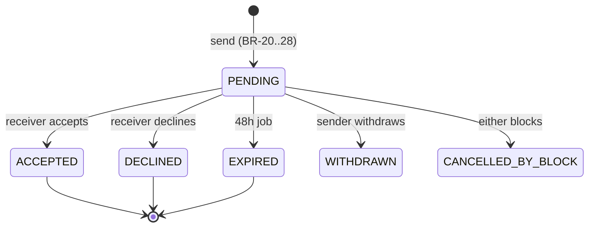
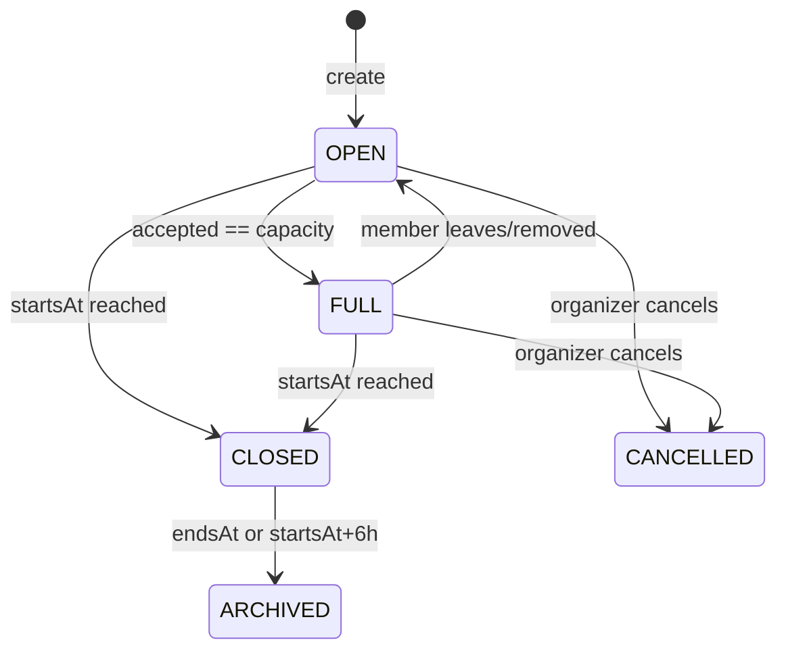
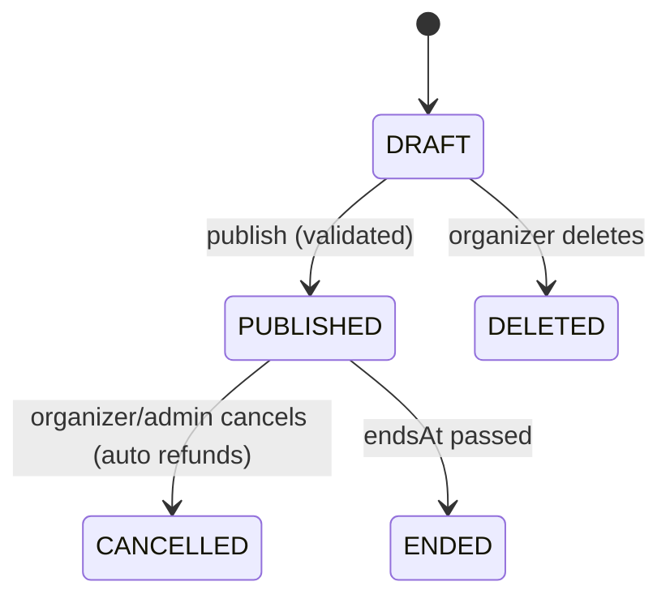
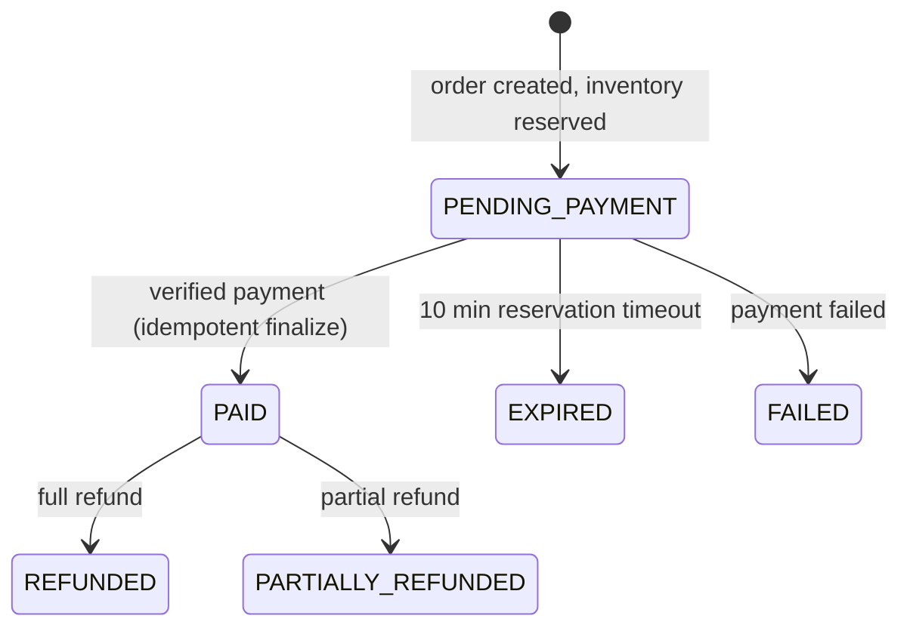

# Hello · Pool · Events — Product & Implementation Blueprint

**Android (Kotlin + XML Views) + Node/TypeScript backend + minimal admin web**
Version 2.0 · 2026-10-17 · Owner: Dev
Working name: **Hello** (placeholder; use `{AppName}` in copy and `com.hello.app` as the placeholder package until decided).

> **Honest-status rule:** a feature is only **done** when it works against the real backend with automated tests. UI-only or in-memory demo behavior is labeled `[demo]` and never counted as complete.
> Status labels: `[ ]` planned · `[~]` in progress · `[x]` done (real, tested) · `[demo]` UI/in-memory only.

## Table of contents

0. How to use this document (humans and AI)
1. Product definition
2. Roles, account states, permissions
3. Glossary and business rules
4. App structure and navigation
5. User flows
6. Screen catalog
7. State machines
8. Data model
9. API specification
10. Realtime and notifications
11. Location and privacy specification
12. Tech stack and architecture
13. Engineering best practices
14. Design system, motion and UX copy
15. Authentication: SMS OTP
16. Events, payments and ticketing in detail
17. Environments, configuration and hosting
18. Phased implementation plan
19. Security and privacy requirements
20. Observability and operations
21. Testing strategy
22. CI/CD
23. Cost model
24. Compliance and legal checklist
25. Top risks
26. AI build prompts
27. Definition of MVP done and doc maintenance
Appendix A: error codes · Appendix B: analytics events

---

## 0. How to use this document (humans and AI)

### 0.1 Precedence
1. This document is the source of truth. If a chat instruction conflicts with it, stop and ask which wins; if the human says the chat wins, update the doc.
2. If the document is silent, use the default in §1.9 (Open decisions). If there is no default, ask **one** question; do not guess silently.
3. Business rules (§3) have IDs (`BR-xx`). Every rule needs at least one automated test whose name contains the ID.

### 0.2 Context map: what to attach for each task
The document is large. Give the AI only the sections it needs, plus §0, §3 and §13 every time.

| Task | Attach |
|---|---|
| Repo/CI skeleton | §12, §13, §17, §22 |
| Design system | §14, §13 (Android) |
| Auth + onboarding | §5.1–5.2, §6 (A-screens), §8, §9 (Auth, Me), §15 |
| Discovery | §5.3, §6 (D), §9 (Presence), §11 |
| Hello + chat + realtime | §5.4–5.5, §6 (H, C), §7, §9, §10 |
| Pools | §5.6–5.7, §6 (P), §7, §9 (Pools) |
| Events + tickets | §5.8–5.10, §6 (E), §7, §9, §16 |
| Safety + launch | §5.11–5.13, §6 (X, S), §19, §20, §24 |

### 0.3 Slice workflow (required for every task)
1. **Plan**: restate the goal, list files to touch, list risks and assumptions.
2. **Build vertically**: migration → service → route → OpenAPI → Android repository → ViewModel → UI → tests.
3. **Test**: unit + integration for each `BR-xx` touched; list what was run and the result.
4. **Docs**: update API docs, data model, screen catalog, and the status labels.
5. **Report**: what is done, what is `[demo]`, what remains, what questions are open.

### 0.4 Definition of Done (per slice)
- [ ] Works against the real backend (no in-memory fakes in the shipped path)
- [ ] Loading, empty, error, offline states implemented (§14.6)
- [ ] Business rules enforced server-side, with tests
- [ ] Lint, typecheck, unit tests green in CI
- [ ] Accessible: labels, 48dp targets, dark mode, font scale 1.3×
- [ ] No secrets, no PII in logs, no hardcoded strings
- [ ] Docs and status labels updated

### 0.5 Output conventions for the AI
- Show full file paths. Output complete files, not fragments, for new files.
- No `TODO` without a linked checklist item. No placeholder implementations presented as finished.
- Keep commits small and conventional (`feat(hello): ...`, `fix(auth): ...`).
- Never weaken a safety assertion (§15.6) or a business rule to make a test pass.

---

## 1. Product definition

### 1.1 Vision
Hello helps adults in the same city take the awkward first step toward meeting people in person: safely, with consent, and with low pressure. It then turns that intent into real plans through small **Pools** and ticketed **Events**.

### 1.2 Problem
- Meeting new people offline is hard; most apps are built around profiles and swiping, not around plans.
- Unsolicited DMs create harassment and anxiety, especially for women.
- Group plans live in chaotic chats; event discovery and ticketing are fragmented.

### 1.3 Value proposition
1. **Consent-first contact:** nobody can message you until you accept their single, short Hello.
2. **Intent signaling:** your Availability says whether you want to be approached right now.
3. **Small plans, not big feeds:** Pools are small, time-bound, organizer-approved.
4. **Events in the same app:** discover, pay, get a QR ticket, get checked in.
5. **Privacy by design:** your exact location is never shown to anyone.

### 1.4 Positioning (see OD-3)
A social discovery app for meeting new people (friends, activity partners, dates). It is **not** a dating app by design: no romantic-intent fields, no swiping. Revisit if Google Play classifies it under dating policies.

### 1.5 Target users and personas (launch city or campus only)
| Persona | Description | Needs |
|---|---|---|
| **Aarav, 21**, student, new in town | Wants friends for sports, cafes, trips | Low-pressure ways to start, cheap events |
| **Meera, 28**, working professional | Safety-conscious, wants curated social plans | Consent control, hidden exact location, easy block/report |
| **Rohan, 30**, community event host | Runs workshops, open mics, small gigs | Easy ticketing, QR check-in, revenue visibility |
| **Moderator/Admin** (internal) | Keeps the community safe | Report queue, suspension, audit trail |

### 1.6 Core user stories (MVP)
| ID | As a… | I want to… | So that… | Priority |
|---|---|---|---|---|
| US-1 | New user | Sign up with phone OTP and confirm I'm 18+ | I can use the app safely | Must |
| US-2 | User | Set my Availability | People know whether to approach me | Must |
| US-3 | User | See nearby people approximately | I can choose whom to greet without being tracked | Must |
| US-4 | User | Send one short Hello | I can start a conversation with consent | Must |
| US-5 | User | Accept or decline Hellos | I control who contacts me | Must |
| US-6 | User | Chat with my connections in real time | I can plan to meet | Must |
| US-7 | User | Create a Pool with time, place, capacity | I can invite people to a plan | Must |
| US-8 | User | Knock to join Pools and chat with the group | I can join plans | Must |
| US-9 | User | Browse nearby Events and buy tickets | I can attend | Must |
| US-10 | User | Show a QR ticket at the door | I get in quickly | Must |
| US-11 | Organizer | Publish Events with tiers | I can sell tickets | Must |
| US-12 | Organizer | Scan tickets and see who checked in | I control entry | Must |
| US-13 | Organizer | See sales and fees clearly | I trust the numbers | Should |
| US-14 | User | Block and report anyone, anywhere | I feel safe | Must |
| US-15 | User | Export or delete my data | I control my data | Must |
| US-16 | Moderator | Review reports, suspend users, handle appeals | The community stays safe | Must |

### 1.7 MVP scope
| In scope (MVP) | Out of scope (deferred) |
|---|---|
| Phone OTP auth, 18+ gate, onboarding | Google sign-in, email login |
| Availability + fuzzy nearby discovery (foreground location) | Background location, "live" tracking |
| Hello → Connection → text-only DMs | Media/voice/video messages, read receipts, typing indicators |
| Pools + Knocks + group chat | Recurring Pools, paid Pools |
| Events, tiers, Razorpay test→live, QR tickets, online check-in | Offline scanning, staff scanner roles, seating charts, promo codes |
| Report, block, suspend, appeal, admin web (basic) | ML moderation, selfie verification badges |
| Account deletion and data export | Premium subscription, wallet/payouts via gateway, creator content |
| English UI (strings externalized) | Hindi/other languages, iOS |

### 1.8 Success metrics (first 90 days of beta)
| Metric | Target (initial guess) |
|---|---|
| Onboarding completion (phone entered → availability set) | ≥ 60% |
| Hello accept rate | ≥ 30% |
| Chats with ≥ 3 messages from a Connection | ≥ 50% of Connections |
| Pool fill rate (≥ 2 members within 48h of creation) | ≥ 40% |
| Checkout conversion (tier picked → paid) | ≥ 35% |
| Reports per 1,000 active users / week | Tracked; median time-to-first-action < 24h |
| D7 retention | ≥ 20% |
| Crash-free sessions | ≥ 99% |

### 1.9 Open decisions and the defaults the AI must assume
Change a default by editing this table. The AI must flag any place it relies on a default.

| ID | Decision | Default assumed |
|---|---|---|
| OD-1 | Launch geography | One city or campus; platform max discovery radius 25 km |
| OD-2 | App name / package | `Hello` / `com.hello.app` (placeholder) |
| OD-3 | Positioning | Social discovery, not dating (see §1.4) |
| OD-4 | Availability states | `OFF` invisible · `OPEN` visible and accepts Hellos · `BROWSING` visible, can send but **not** receive Hellos · `AT_EVENT` visible with event badge, accepts Hellos |
| OD-5 | Hello limits | 20 sent/day; 5/day during the first 24h of the account; same recipient blocked for 7 days after decline, 24h after expiry |
| OD-6 | Decline visibility | Decline is silent; sender sees "No response" when it expires |
| OD-7 | Date of birth | Stored server-side, never exposed; age shown only if the user opts in (`showAge`) |
| OD-8 | Verification badge | None in MVP (phone-verified is baseline, not a badge) |
| OD-9 | Chat | Text only, ≤ 1000 chars; delete own message (tombstone); no edit; states: sending/failed/sent/delivered; no read receipts, no typing |
| OD-10 | Pool | Capacity 2–12 including organizer; starts within 14 days; organizer approves Knocks; knocks close at `startsAt`; exact venue shown only to accepted members; archived 6h after start unless `endsAt` set |
| OD-11 | Organizer onboarding | In-app application (org name, description, links); admin approves manually |
| OD-12 | Platform fee and payouts | Fee 5% (config, placeholder); payouts are manual bank transfers by admin, recorded in the ledger; gateway payouts later |
| OD-13 | Refunds | Automatic full refund if Event is cancelled; otherwise no self-serve refunds in MVP; disputes handled by admin |
| OD-14 | Ticket limits | ≤ 6 per order, ≤ 10 per user per Event; reservation hold 10 min |
| OD-15 | Check-in | Online only; organizer of that Event only |
| OD-16 | Location | Foreground only; location required for Discover and Pools; Events browsable without it |
| OD-17 | Language | English only; all strings in `strings.xml` |
| OD-18 | Account deletion | 30-day grace (cancel by logging in), then anonymize; export is a JSON file valid for 7 days |
| OD-19 | Google sign-in | Post-MVP; an account always has a verified phone |
| OD-20 | Android versions | `minSdk 26`; `targetSdk`/`compileSdk` = latest stable at build time |
| OD-21 | Photos | 1 required, up to 6; moderated by reports in MVP |
| OD-22 | Event categories | Music, Food & Drink, Sports & Fitness, Arts & Culture, Workshops, Networking, Nightlife (18+ only), Outdoors, Other |
| OD-23 | Currency/tax | INR only; GST/TCS/invoicing treatment needs accountant review before live payments |
| OD-24 | Admin web | Small React (Vite) SPA on a static host, calling `/v1/admin/*`; admin accounts are normal users with role `MODERATOR`/`ADMIN` plus OTP re-auth |

---

## 2. Roles, account states, permissions

### 2.1 Roles
`USER` (default) · `isOrganizer` flag on a user (granted after approval) · `MODERATOR` · `ADMIN`.

### 2.2 Account states
| State | Meaning | Allowed |
|---|---|---|
| `ONBOARDING` | Phone verified, onboarding incomplete | Finish onboarding, logout, delete |
| `ACTIVE` | Normal | Everything per role |
| `SUSPENDED` | Moderation action in force | Appeal, export, delete, logout, view own tickets, receive refunds. Not visible anywhere; cannot send Hellos/messages/Knocks/create content |
| `DELETION_PENDING` | In 30-day grace | Invisible; can cancel deletion by signing in and confirming |
| `DELETED` | Anonymized | Nothing |

### 2.3 Permission matrix (server-enforced)
| Action | Onboarding | Active user | Organizer | Moderator | Admin | Suspended |
|---|---|---|---|---|---|---|
| Update own profile | ✓ | ✓ | ✓ | ✓ | ✓ | ✗ |
| Appear in discovery | ✗ | ✓ | ✓ | ✓ | ✓ | ✗ |
| Send Hello / message / Knock | ✗ | ✓ | ✓ | ✓ | ✓ | ✗ |
| Create Pool | ✗ | ✓ | ✓ | ✓ | ✓ | ✗ |
| Buy ticket | ✗ | ✓ | ✓ | ✓ | ✓ | ✗ |
| Create/publish Event | ✗ | ✗ | ✓ | ✗ | ✓ | ✗ |
| Scan tickets for an Event | ✗ | ✗ | own Events only | ✗ | ✓ | ✗ |
| View report queue | ✗ | ✗ | ✗ | ✓ | ✓ | ✗ |
| Suspend/unsuspend | ✗ | ✗ | ✗ | ✓ (temporary) | ✓ (any) | ✗ |
| Approve organizers, issue refunds, view audit log | ✗ | ✗ | ✗ | ✗ | ✓ | ✗ |

---

## 3. Glossary and business rules

### 3.1 Glossary
| Term | Meaning |
|---|---|
| Availability | Current social intent: `OFF`, `OPEN`, `BROWSING`, `AT_EVENT` |
| Hello | Consent-gated first message, max 280 chars |
| Connection | Created when a received Hello is accepted; unlocks DMs |
| Pool | Small, time-bound casual group plan |
| Knock | Request to join a Pool, optional message ≤ 120 chars |
| Happening | Area containing nearby Pools and Events |
| Organizer | User allowed to create/publish/manage Events and check in attendees |
| Ticket tier | Event price/capacity option; price in paise |
| Order | A purchase attempt for one tier and quantity |
| Booking reference | Human-facing unique ticket identifier |
| QR value | Unique machine-readable check-in token |
| Sandbox number | Allow-listed phone with a fixed OTP and no SMS sent |
| Fuzzy location | Approximate position/distance that never reveals exact coordinates |

### 3.2 Business rules (server-enforced; the client is never trusted)
Each rule has an ID used in test names.

**Identity and eligibility**
- **BR-01** Users must be 18+; age is computed server-side from stored DOB. Under-18 cannot reach any discovery, social or payment feature.
- **BR-02** Phone identity is established by OTP; one account per phone number.
- **BR-03** Map visibility requires `ACTIVE` status, completed onboarding, location eligibility, accepted guidelines, and availability ≠ `OFF`.
- **BR-04** No verification badge is shown unless a real verification occurred (none in MVP).

**Discovery and privacy**
- **BR-10** Exact coordinates are never returned by any API, log line or notification.
- **BR-11** Blocked pairs are invisible to each other in profiles, nearby results, Hellos, messages, Pool surfaces and notifications.
- **BR-12** Discovery radius: user setting 1–25 km (default 5), platform maximum 25 km.
- **BR-13** Stale presence expires after 30 minutes without a foreground update.
- **BR-14** Nearby queries are anchored to the user's own last reported position, never to an arbitrary client-supplied center.

**Hellos and connections**
- **BR-20** Hello message is 1–280 chars after trimming.
- **BR-21** Only one `PENDING` Hello per sender→receiver pair.
- **BR-22** Pending Hellos expire after 48 hours.
- **BR-23** Only the receiver may accept or decline.
- **BR-24** Acceptance atomically creates exactly one Connection and one DM conversation.
- **BR-25** Decline/expiry creates nothing; decline is silent to the sender (OD-6).
- **BR-26** A Hello may be sent only if the receiver is currently discoverable to the sender and has availability `OPEN` or `AT_EVENT`.
- **BR-27** If the receiver already has a pending Hello to the sender, sending a Hello accepts that one instead (mutual interest).
- **BR-28** Daily send caps and cooldowns apply (OD-5).

**Messaging**
- **BR-30** DMs require a Connection; Pool messages require active membership.
- **BR-31** Sender is always the authenticated user.
- **BR-32** Message body 1–1000 chars; `clientMsgId` makes sends idempotent.
- **BR-33** Blocking removes the DM conversation from both users' lists; content is retained for moderation per retention policy.
- **BR-34** Messages from a user the viewer has blocked are excluded from that viewer's Pool chat fetches.

**Pools**
- **BR-40** Creator is organizer and first member.
- **BR-41** Capacity 2–12 including the organizer; accepted members never exceed capacity.
- **BR-42** Knock message ≤ 120 chars; no duplicate membership; no duplicate pending Knock.
- **BR-43** Only the organizer manages Knocks or edits/cancels the Pool.
- **BR-44** Pools stop accepting Knocks at `startsAt` and are archived automatically.
- **BR-45** Exact venue is returned only to accepted members.
- **BR-46** A user cannot Knock on a Pool organized by someone they blocked or who blocked them.

**Events and tickets**
- **BR-50** Only approved organizers create, modify, publish, or cancel Events.
- **BR-51** Only published, non-ended, non-cancelled Events are public.
- **BR-52** Price is an integer in paise. Inventory (`reserved + sold`) never exceeds capacity.
- **BR-53** Tickets are issued only after server-verified payment (or an explicit free tier).
- **BR-54** Payment finalization is idempotent (webhook replays, client confirms and retries are safe).
- **BR-55** Unpaid orders release their reservation after 10 minutes.
- **BR-56** Check-in requires the correct organizer and Event and a `CONFIRMED`, unused ticket; check-in time is immutable except via an audited admin correction.
- **BR-57** The organizer revenue ledger is append-only; balances are derived from entries.
- **BR-58** Cancelling an Event refunds all paid orders automatically.

**Notifications**
- **BR-60** Important activity is persisted in the in-app inbox before any push is sent.
- **BR-61** Push respects user preferences and OS permission; safety/account notices cannot be disabled.
- **BR-62** Push payloads never contain message text or location (generic text only).

**Safety**
- **BR-70** Block is immediate and applies to every surface including notifications.
- **BR-71** Reports and moderation actions are access-controlled and audited.
- **BR-72** Suspension blocks protected actions and always offers an appeal path.
- **BR-73** Emergency copy states the app is not an emergency service and points to local emergency numbers.

---

## 4. App structure and navigation

### 4.1 Structure
Single Activity (`MainActivity`) hosting Navigation Component graphs. Pre-login flows live in an `auth` graph; the main app is a bottom-navigation shell with five tabs, each with its own nested graph and preserved back stack.

```
Launch ─► Splash ─► ┬─ Auth graph (Welcome → Phone → OTP → DOB → Profile → Guidelines → Permissions → Availability)
                    ├─ Suspended screen
                    ├─ Force-update / Maintenance screen
                    └─ Main shell
                         ├─ Tab 1  Discover   (Map ⇄ List)
                         ├─ Tab 2  Happening  (Pools | Events)
                         ├─ Tab 3  Inbox      (Chats | Hellos)
                         ├─ Tab 4  Tickets    (Upcoming | Past)
                         └─ Tab 5  Profile    (profile, settings, organizer entry)
Top app bar (all tabs): notification bell with unread badge → Notification inbox
```

### 4.2 Navigation rules
- Back from a tab root returns to Discover; from Discover it exits the app.
- Bottom sheets (Hello compose, Knock, Report, Availability) are modal destinations and dismiss on back.
- Container transform for card → detail; shared-axis for steppers (§14.4).
- Every list item that opens a detail passes only an ID; the destination loads its own data (supports deep links and process death).
- Auth-expired (refresh fails) → clear session → Auth graph, preserving the intended deep link.

### 4.3 Deep links and notification routing
| Trigger | Destination |
|---|---|
| New Hello | Inbox → Hellos → Hello detail (H03) |
| Hello accepted | Chat thread (C02) |
| New message | Chat thread (C02) |
| Knock received | Manage Pool → Requests (P05) |
| Knock accepted/declined | Pool detail (P02) |
| Ticket issued / payment confirmed | Ticket detail (E07) |
| Event cancelled/refund | Ticket detail (E07) |
| Moderation notice | Safety/Suspended (X02) or Notification inbox |
| Anything else | Notification inbox (N01) |

Use verified App Links (`https://<domain>/…`) for web-to-app links, and keep the route table in `docs/screen-catalog.md`.

---

## 5. User flows

Notation: `→` happy path · `✗` branch/failure · `(BR-xx)` rule reference.

### 5.1 First launch → onboarding
1. Splash: read stored session; call `GET /v1/config` (min version, flags).
   - `✗` version below minimum → Force-update (A12). `✗` maintenance flag → A13.
2. No session → Welcome (A02) → Phone (A03).
3. Enter +91 number → `POST /auth/otp/request` → OTP (A04). `✗` `rate_limited` shows countdown; `✗` `country_not_supported` explains.
4. SMS Retriever auto-fills code; verify → tokens stored.
5. `isNewUser` → DOB (A05). Under 18 → A06 (blocked, session cleared) (BR-01).
6. Profile setup (A07): name, ≥ 1 photo, interests. Guidelines (A08) must be accepted.
7. Location rationale (A09) → system permission. `✗` denied: continue in limited mode (Events only), with persistent banner on Discover.
8. Notification rationale (A10), skippable.
9. Set Availability (A11), default selection `OPEN`, then `PUT /presence` → Main shell on Discover.

### 5.2 Returning launch
1. Valid refresh token → silently refresh → Main shell. Invalid → Auth.
2. Status `SUSPENDED` → X02 only. `DELETION_PENDING` → prompt "Cancel deletion?" (S08).
3. Cold-start tolerance: after 4s show "Waking up the server…" (§15.9).

### 5.3 Discover
1. Discover opens; app requests foreground location; sends `PUT /presence` with availability.
2. `GET /discovery/nearby` returns paged fuzzy cards and map markers (§11).
3. Tap marker/card → preview sheet (D03) → profile (D04) or "Say Hello".
4. `✗` location off/denied → state with "Enable location" action.
5. `✗` availability `OFF` → banner "You're invisible. Turn on visibility to see people".
6. User leaves the screen/app → presence stops updating; it expires in 30 min (BR-13).

### 5.4 Send a Hello
1. From D03/D04 tap **Say Hello** → compose sheet (H01), 280-char counter.
2. Send → `POST /hellos` (with `Idempotency-Key`).
   - `✗` already pending → "Hello already sent". `✗` cap reached (BR-28). `✗` receiver no longer available (BR-26). `✗` blocked → generic "unavailable".
   - Mutual case (BR-27): response is `{connected: true, conversationId}` → celebration (H04).
3. Success: fly-away animation; profile shows "Hello sent · expires in 48h" with Withdraw.

### 5.5 Receive and accept a Hello, then chat
1. Push/in-app notification → H03 shows sender card and message.
2. **Accept** → `POST /hellos/{id}/accept` → Connection + conversation → H04 → Chat (C02).
   **Decline** → silent; Hello removed from list.
3. Chat: type → optimistic bubble (`clientMsgId`) → `POST …/messages` → WebSocket echo → state `sent`; recipient device ack → `delivered`.
4. `✗` offline: bubble shows "Failed · Retry"; auto-retry on reconnect with the same `clientMsgId`.
5. Block from chat info → conversation disappears for both (BR-33, BR-70).

### 5.6 Create a Pool
1. Happening → Pools → FAB "Create Pool" (P03).
2. Step 1 basics: title (≤ 80), category, description (≤ 500).
3. Step 2 when/where: start time (≤ 14 days ahead), optional end, venue name + map pin (exact stored privately; public area label).
4. Step 3 capacity (2–12) and review → `POST /pools`.
5. Creator becomes member and organizer; Pool chat is created.

### 5.7 Knock and join a Pool
1. Pool detail (P02) → **Knock** → sheet (P04) with optional message.
2. `POST /pools/{id}/knocks` → state "Knock sent" (withdraw available).
3. Organizer gets a notification → Manage Pool (P05) → Accept/Decline.
4. Accept (transaction with row lock, BR-41) → member added; exact venue unlocked (BR-45); Pool chat accessible.
5. `✗` Pool full → "This Pool just filled up". `✗` past start → "Closed".

### 5.8 Discover an Event and buy tickets
1. Happening → Events (E01) → Event detail (E02) → **Get tickets**.
2. Tier picker (E03): choose tier + quantity (≤ per-order max).
3. `POST /events/{id}/orders` (with `requestId`) → reservation (10 min) + Razorpay order → Checkout (E04) with countdown.
4. Razorpay SDK checkout → success callback → `POST /orders/{id}/confirm` with payment ids and signature.
5. E05 shows "Confirming payment…" and polls `GET /orders/{id}` up to 60s; ticket(s) appear (E07). Push "Your ticket is ready" also arrives if the app was closed.
6. `✗` payment failed/cancelled → retry within the reservation window; `✗` reservation expired → return to tier picker; `✗` sold out → message.
7. Free tier: skip payment; `POST …/orders` returns confirmed tickets directly.

### 5.9 Organizer: apply and create an Event
1. Profile → "Become an organizer" (E08) → application → admin decision (notification).
2. Organizer dashboard (E09) → Create Event (E10): basics → date/venue → tiers (name, price in ₹ shown, stored in paise, capacity, per-order max) → review → **Publish** (`POST …/publish`).
3. After publish, only safe fields are editable (description, cover); price/capacity may only increase capacity; cancel is a separate destructive action with confirmation (BR-58).

### 5.10 Check-in at the door
1. Organizer opens Event management (E11) → **Scan** (E12).
2. Camera reads QR → `POST /events/{id}/checkins` → result overlay (E13): `VALID`, `ALREADY_USED` (with time), `INVALID`, `WRONG_EVENT`, `NOT_CONFIRMED`, `REFUNDED`.
3. Distinct haptics/sounds per result; manual entry by booking reference as fallback.
4. `✗` offline → clear "No connection" state; scans are not queued (OD-15).

### 5.11 Block and report
1. From any profile, message, Pool or Event: overflow → **Report** (X01) or **Block**.
2. Report: reason → details → optional screenshot → submit → confirmation with "Also block this user?".
3. Block: confirm dialog → effect is immediate everywhere (BR-70); Settings → Blocked users (S05) allows unblock.
4. Moderator reviews in admin queue; actions notify the reported user (without revealing the reporter).

### 5.12 Account deletion and data export
1. Settings → Delete account (S08): explains consequences (active tickets, Pools, ledger retention), requires OTP re-auth, confirm.
2. State `DELETION_PENDING` for 30 days (invisible; can cancel by signing in). After 30 days: anonymize profile, delete messages per policy, revoke sessions, retain legally required payment records.
3. Export (S07): request → job builds JSON → notification "Your export is ready" → download link valid 7 days.
4. Public web page `/delete-account` explains how to request deletion without the app.

### 5.13 Suspension and appeal
1. Moderator suspends (duration or permanent) → user's sessions get `session.revoked`; next launch shows X02.
2. User submits an appeal (X04, one open appeal at a time). Admin decides; user is notified.

### 5.14 Offline, cold start, errors
- Offline banner is global; cached lists (chats, Hellos, tickets) remain readable; writes show retry.
- Tickets and QR are cached locally so the QR can be shown with no network.
- Server errors use the standard envelope; the client maps `error.code` to localized copy (Appendix A).

---

## 6. Screen catalog

Every screen has a default state plus: **loading** (shimmer), **empty**, **error with retry**, **offline**. Only extra/special states are listed.

### 6.1 App shell and system (A)
| ID | Screen | Contents and actions | Special states | APIs |
|---|---|---|---|---|
| A01 | Splash | Logo, session check, routing | Waking-up message after 4s | `GET /config`, `POST /auth/refresh` |
| A02 | Welcome | 3-card value carousel, Continue, legal links | – | – |
| A03 | Phone entry | +91 prefix locked, number field, Continue, consent text | invalid number, rate-limited countdown, country blocked | `POST /auth/otp/request` |
| A04 | OTP entry | Six boxes (one hidden input), masked phone, edit number, resend timer, autofill | wrong code shake, locked, expired | `POST /auth/otp/verify` |
| A05 | Date of birth | Date picker, why we ask | under-18 → A06 | `PUT /me/dob` |
| A06 | Under-18 blocked | Explanation, support link, no way forward | – | – |
| A07 | Profile setup | Name, photos (1–6), bio (≤ 160), interests (pick 3–8), progress | upload progress/failure, photo rejected | `PATCH /me/profile`, photo endpoints |
| A08 | Community guidelines | Short rules, must accept | – | `POST /me/guidelines/accept` |
| A09 | Location rationale | Fuzzy location explanation, Allow / Not now | denied, permanently denied → Settings | – |
| A10 | Notification rationale | Why, Allow / Skip | – | `PUT /me/devices` |
| A11 | Set availability | Four options with descriptions | – | `PUT /presence` |
| A12 | Force update | Update button to Play Store | – | `GET /config` |
| A13 | Maintenance | Message, retry | – | `GET /config` |

### 6.2 Discovery (D)
| ID | Screen | Contents and actions | Special states | APIs |
|---|---|---|---|---|
| D01 | Discover map | MapLibre, fuzzy clustered markers, radius ring, availability chip, list toggle, filters, my-location FAB | no permission, location off, `OFF` banner, no results | `GET /discovery/nearby`, `PUT /presence` |
| D02 | Discover list | Cards (photo, name, age if shown, distance bucket, availability badge, shared interests), pull-to-refresh, paging | same as D01 | same |
| D03 | User preview sheet | Photo, name, bucket, bio snippet, **Say Hello**, View profile, overflow (report/block) | Hello pending/connected variants | `GET /users/{id}` |
| D04 | Public profile | Photo pager, bio, interests, availability, actions | pending Hello with Withdraw; connected → Message | `GET /users/{id}` |
| D05 | Availability sheet | Four states with explanations; `AT_EVENT` only if the user has a ticket for a current Event | – | `PUT /presence` |
| D06 | Filters sheet | Radius slider, interests, availability | – | query params |

### 6.3 Hello (H) and Chat (C)
| ID | Screen | Contents and actions | Special states | APIs |
|---|---|---|---|---|
| H01 | Hello compose sheet | Recipient mini-card, text (280 counter), tips, Send | cap reached, already pending, unavailable | `POST /hellos` |
| H02 | Hellos list (Inbox tab) | Received/Sent toggle, countdown per item, badge | empty ("No Hellos yet") | `GET /hellos` |
| H03 | Hello detail | Sender card, message, expiry, Accept/Decline, report/block | expired, withdrawn | `GET /hellos/{id}`, accept/decline |
| H04 | Connected celebration | Lottie, "Say hi" → chat | – | – |
| C01 | Chats list (Inbox tab) | Avatar, name, last-message preview, time, unread dot; DM and Pool chats with type icon | empty | `GET /conversations` |
| C02 | Chat thread | Day-grouped bubbles, composer (≤ 1000), delete own, report message, paging older | sending/failed/sent/delivered, reconnecting banner, blocked/ended | messages endpoints, WS |
| C03 | Chat info | DM: user card, mute, disconnect, block, report. Pool: members, leave, mute | – | connections/blocks/pools |

### 6.4 Pools (P)
| ID | Screen | Contents and actions | Special states | APIs |
|---|---|---|---|---|
| P01 | Happening: Pools | List/map toggle, category and time filters, FAB Create | no location, empty | `GET /pools/nearby` |
| P02 | Pool detail | Title, organizer, time, area (exact venue for members), description, capacity meter, member avatars, CTA by relation (Knock / Knock sent / Open chat / Manage) | full, closed, cancelled, blocked-hidden | `GET /pools/{id}` |
| P03 | Create/Edit Pool | 3-step stepper with validation | unsaved-changes dialog | `POST/PATCH /pools` |
| P04 | Knock sheet | Optional message (120), Send | duplicate, full, closed | `POST /pools/{id}/knocks` |
| P05 | Manage Pool | Tabs: Requests (accept/decline), Members (remove), Edit, Cancel | no requests | knocks/members endpoints |
| P06 | My Pools | Upcoming / Past / Organized | empty | `GET /me/pools` |
| P07 | Members list | Avatars, names, organizer badge | – | `GET /pools/{id}/members` |

### 6.5 Events and tickets (E)
| ID | Screen | Contents and actions | Special states | APIs |
|---|---|---|---|---|
| E01 | Happening: Events | Cards (cover, date, price from, venue), filters (date, category, free/paid) | empty | `GET /events/nearby` |
| E02 | Event detail | Cover, organizer, date, venue map (exact), description, tier preview, policies, Share, **Get tickets** | sold out, ended, cancelled | `GET /events/{id}` |
| E03 | Tier picker | Tiers, price, scarcity hint ("Few left"), quantity stepper, subtotal and fees | sold out tier | – |
| E04 | Checkout | Summary, 10:00 reservation countdown, Pay (Razorpay), terms | expiry, payment error | `POST /events/{id}/orders` |
| E05 | Payment result | Success (Lottie) / pending ("Confirming…") / failed / expired | polling timeout → "We'll notify you" | `POST /orders/{id}/confirm`, `GET /orders/{id}` |
| E06 | My tickets | Upcoming / Past; cards with status chips | empty | `GET /me/tickets` |
| E07 | Ticket detail | Large QR, brightness boost, booking ref, event info, status chip, add to calendar, directions | checked-in, refunded, cancelled; works offline from cache | `GET /tickets/{id}` |
| E08 | Organizer apply | Form + status (pending/approved/rejected) | – | `POST /organizer/applications` |
| E09 | Organizer dashboard | My Events (Draft/Published/Past), revenue summary, Create | – | `GET /organizer/events` |
| E10 | Create/Edit Event | 4-step stepper: basics → date/venue → tiers → review/publish | draft autosave, publish validation errors | organizer endpoints |
| E11 | Event management | Stats (sold, checked-in), attendee search, Scan button, Cancel Event | – | attendees/summary |
| E12 | Scanner | CameraX preview, torch, manual booking-ref entry | permission denied, no network | `POST /events/{id}/checkins` |
| E13 | Scan result overlay | Full-screen color + icon + text + haptic per result | – | – |
| E14 | Revenue ledger | Gross, platform fee, refunds, net; entries list | – | `GET /organizer/ledger` |

### 6.6 Notifications (N), Profile/Settings (S), Safety (X)
| ID | Screen | Contents and actions | Special states | APIs |
|---|---|---|---|---|
| N01 | Notification inbox | Day-grouped list, tap routes (§4.3), mark all read | empty | `GET /notifications` |
| N02 | Notification settings | Category toggles, system-permission status | OS permission denied | preferences endpoints |
| S01 | My profile | As-others-see preview, Edit, quick availability, links | – | `GET /me` |
| S02 | Edit profile | Photos reorder, name, bio, interests | – | `PATCH /me/profile` |
| S03 | Settings | List: Privacy, Notifications, Blocked, Sessions, Data, Delete, About, Help | – | – |
| S04 | Privacy and visibility | Availability, radius, show age | – | `PUT /me/settings` |
| S05 | Blocked users | List, unblock | empty | `GET /blocks` |
| S06 | Sessions and devices | List, revoke, "log out everywhere" | – | auth sessions |
| S07 | Data export | Request, status, download | processing, expired | `POST /me/data-export` |
| S08 | Delete account | Consequences, OTP re-auth, confirm; pending state with Cancel | – | `POST /me/delete` |
| S09 | About and legal | Version, privacy, terms, licenses, guidelines | – | – |
| S10 | Help and support | Contact, grievance officer, FAQ | – | – |
| X01 | Report flow | Reason → details (≤ 500) → optional screenshot → submit → "also block?" | – | `POST /reports` |
| X02 | Suspended | Reason summary, duration, Appeal, Export, Delete, Logout | permanent vs temporary | `POST /me/appeals` |
| X03 | Safety center | Tips, guidelines, emergency notice (not an emergency service; dial 112 in India) | – | – |
| X04 | Appeal form and status | Message, status | pending/decided | appeals endpoints |

### 6.7 Admin web (AD), minimal
`AD01` Login · `AD02` Report queue · `AD03` Report detail (target content with surrounding messages, user history, action buttons) · `AD04` User search/detail (suspend/unsuspend, sessions) · `AD05` Appeals · `AD06` Organizer applications · `AD07` Events (takedown) · `AD08` Orders/refunds · `AD09` Audit log. All actions are role-checked and written to `AuditLog`.


---

## 7. State machines

Illegal transitions must be rejected by the service layer and covered by tests.

### 7.1 Hello


### 7.2 Pool and Knock

Knock: `PENDING → ACCEPTED | DECLINED | WITHDRAWN | EXPIRED` (expires at Pool `startsAt`).

### 7.3 Event


### 7.4 Order and Ticket

Ticket: `CONFIRMED → CHECKED_IN` (terminal for scanning), `CONFIRMED → REFUNDED | CANCELLED`. A ticket is checked in iff `checkedInAt IS NOT NULL`.

### 7.5 Account and moderation
`ONBOARDING → ACTIVE → SUSPENDED → ACTIVE` (unsuspend/expiry) · `ACTIVE|SUSPENDED → DELETION_PENDING → DELETED` (30 days) · `DELETION_PENDING → ACTIVE` (cancel).
Report: `OPEN → IN_REVIEW → ACTIONED | DISMISSED`. Appeal: `PENDING → UPHELD | OVERTURNED`.

---

## 8. Data model

Reference schema in Prisma syntax. Relation fields are omitted for brevity; the AI must add them. Rules for the whole schema:

- IDs are **UUIDv7** generated in the application (time-sortable; cursor pagination by `id`).
- Every `DateTime` uses `@db.Timestamptz(3)` and is stored in UTC.
- Money is `Int` in paise. Currency is always `INR` in MVP (`currency` column kept for future).
- Spatial columns use PostGIS `geography(Point,4326)` via `Unsupported(...)` and raw SQL (verify the extension is enabled on Neon; fallback is a geohash/grid-cell column + Haversine).
- Constraints Prisma cannot express (partial unique indexes, CHECKs, triggers) go in raw SQL migrations, listed in §8.2.

### 8.1 Models
```prisma
enum AccountStatus { ONBOARDING ACTIVE SUSPENDED DELETION_PENDING DELETED }
enum Role { USER MODERATOR ADMIN }
enum Availability { OFF OPEN BROWSING AT_EVENT }
enum HelloStatus { PENDING ACCEPTED DECLINED EXPIRED WITHDRAWN CANCELLED_BY_BLOCK }
enum ConversationType { DM POOL }
enum PoolStatus { OPEN FULL CLOSED CANCELLED ARCHIVED }
enum KnockStatus { PENDING ACCEPTED DECLINED WITHDRAWN EXPIRED }
enum EventStatus { DRAFT PUBLISHED CANCELLED ENDED }
enum OrderStatus { PENDING_PAYMENT PAID EXPIRED FAILED REFUNDED PARTIALLY_REFUNDED }
enum TicketStatus { CONFIRMED REFUNDED CANCELLED }
enum LedgerType { SALE PLATFORM_FEE REFUND FEE_REVERSAL PAYOUT ADJUSTMENT }

model User {
  id                   String   @id
  phoneE164            String   @unique
  phoneVerifiedAt      DateTime?
  role                 Role     @default(USER)
  isOrganizer          Boolean  @default(false)
  status               AccountStatus @default(ONBOARDING)
  dateOfBirth          DateTime? @db.Date
  adultVerifiedAt      DateTime?
  guidelinesAcceptedAt DateTime?
  suspendedUntil       DateTime?
  deletionRequestedAt  DateTime?
  lastActiveAt         DateTime?
  createdAt            DateTime @default(now())
  updatedAt            DateTime @updatedAt
}

model Profile {
  userId          String  @id
  displayName     String            // 2..30
  bio             String?           // <=160
  interests       String[]          // 3..8 from fixed list
  discoveryRadiusKm Int   @default(5) // 1..25
  showAge         Boolean @default(false)
}
model ProfilePhoto { id String @id  userId String  storageKey String  position Int  status String  createdAt DateTime @default(now()) }

model Session {
  id               String   @id
  userId           String
  deviceId         String
  familyId         String            // refresh-token rotation family
  refreshTokenHash String   @unique
  replacedById     String?
  ipHash           String?
  userAgent        String?
  createdAt        DateTime @default(now())
  expiresAt        DateTime
  revokedAt        DateTime?
  @@index([userId]) @@index([familyId])
}
model Device { id String @id  userId String  deviceId String  fcmToken String?  platform String  appVersion String  lastSeenAt DateTime
  @@unique([userId, deviceId]) }

model OtpChallenge { /* see §15.7 */ }

model Presence {
  userId        String   @id
  availability  Availability
  location      Unsupported("geography(Point,4326)")   // PRIVATE, never serialized
  accuracyM     Int?
  cellId        String                                  // ~500 m grid cell
  updatedAt     DateTime
  expiresAt     DateTime
  @@index([cellId]) @@index([expiresAt])
}

model Block { id String @id  blockerId String  blockedId String  createdAt DateTime @default(now())
  @@unique([blockerId, blockedId]) @@index([blockedId]) }

model Hello {
  id          String @id
  senderId    String
  receiverId  String
  message     String
  status      HelloStatus @default(PENDING)
  expiresAt   DateTime
  respondedAt DateTime?
  createdAt   DateTime @default(now())
  @@index([receiverId, status, createdAt]) @@index([senderId, createdAt])
}
model Connection { id String @id  userLowId String  userHighId String  createdAt DateTime @default(now())
  @@unique([userLowId, userHighId]) }       // CHECK userLowId < userHighId

model Conversation { id String @id  type ConversationType  connectionId String? @unique  poolId String? @unique  createdAt DateTime @default(now()) }
model Message {
  id             String @id
  conversationId String
  senderId       String
  clientMsgId    String
  body           String
  deliveredAt    DateTime?               // DM only
  deletedAt      DateTime?               // tombstone
  createdAt      DateTime @default(now())
  @@unique([senderId, clientMsgId])
  @@index([conversationId, id])
}

model Pool {
  id           String @id
  organizerId  String
  title        String       // <=80
  description  String       // <=500
  category     String
  startsAt     DateTime
  endsAt       DateTime?
  capacity     Int          // 2..12 (CHECK)
  status       PoolStatus @default(OPEN)
  venueName    String
  venueLocation Unsupported("geography(Point,4326)")  // PRIVATE until member
  areaLabel    String       // public, e.g. neighbourhood
  areaCell     String
  createdAt    DateTime @default(now())
  @@index([status, startsAt]) @@index([areaCell])
}
model PoolMember { id String @id  poolId String  userId String  joinedAt DateTime @default(now())  leftAt DateTime?
  @@unique([poolId, userId]) }
model PoolKnock { id String @id  poolId String  userId String  message String?  status KnockStatus @default(PENDING)  decidedAt DateTime?  createdAt DateTime @default(now())
  @@index([poolId, status]) }               // partial unique (poolId,userId) WHERE status='PENDING'

model OrganizerApplication { id String @id  userId String  orgName String  description String  links Json?  status String  reviewedBy String?  reviewedAt DateTime?  createdAt DateTime @default(now()) }

model Event {
  id            String @id
  organizerId   String
  title         String
  description   String
  category      String
  venueName     String
  address       String
  location      Unsupported("geography(Point,4326)")  // public venue
  coverKey      String?
  startsAt      DateTime
  endsAt        DateTime
  status        EventStatus @default(DRAFT)
  publishedAt   DateTime?
  salesStartAt  DateTime?
  salesEndAt    DateTime?
  createdAt     DateTime @default(now())
  @@index([status, startsAt])
}
model TicketTier {
  id          String @id
  eventId     String
  name        String
  pricePaise  Int            // 0 = free
  capacity    Int
  reserved    Int @default(0)
  sold        Int @default(0)
  maxPerOrder Int @default(6)
  sortOrder   Int @default(0)
  // CHECK (reserved >= 0 AND sold >= 0 AND reserved + sold <= capacity)
}
model Order {
  id               String @id
  userId           String
  eventId          String
  tierId           String
  quantity         Int
  amountPaise      Int
  platformFeePaise Int
  currency         String @default("INR")
  status           OrderStatus @default(PENDING_PAYMENT)
  razorpayOrderId  String? @unique
  requestId        String
  reservedUntil    DateTime?
  createdAt        DateTime @default(now())
  @@unique([userId, requestId]) @@index([status, reservedUntil])
}
model Payment { id String @id  orderId String  razorpayPaymentId String @unique  amountPaise Int  status String  method String?  capturedAt DateTime? }
model WebhookEvent { id String @id /* provider event id */  provider String  type String  payloadHash String  receivedAt DateTime @default(now())  processedAt DateTime? }
model Ticket {
  id           String @id
  orderId      String
  eventId      String
  tierId       String
  ownerId      String
  bookingRef   String @unique       // e.g. HLO-7K4M-92QX
  qrToken      String @unique       // 32 random bytes, base64url
  status       TicketStatus @default(CONFIRMED)
  checkedInAt  DateTime?
  checkedInBy  String?
  createdAt    DateTime @default(now())
  @@index([eventId]) @@index([ownerId])
}
model Refund { id String @id  orderId String  paymentId String  amountPaise Int  reason String  status String  razorpayRefundId String? @unique  createdAt DateTime @default(now()) }
model LedgerEntry {
  id          String @id
  organizerId String
  eventId     String
  orderId     String?
  type        LedgerType
  amountPaise Int              // signed
  memo        String?
  createdAt   DateTime @default(now())
  @@index([organizerId, createdAt]) @@index([eventId])
}                                // append-only: trigger blocks UPDATE/DELETE

model Notification { id String @id  userId String  type String  payload Json  dedupeKey String?  readAt DateTime?  createdAt DateTime @default(now())
  @@unique([userId, dedupeKey]) @@index([userId, createdAt]) }
model NotificationPreference { userId String  category String  push Boolean @default(true)  inApp Boolean @default(true)  @@id([userId, category]) }

model Report { id String @id  reporterId String  targetType String  targetId String  targetUserId String?  reason String  details String?  evidence Json?  status String @default("OPEN")  assignedTo String?  createdAt DateTime @default(now())  resolvedAt DateTime? }
model ModerationAction { id String @id  reportId String?  targetUserId String  actorId String  action String  reason String  expiresAt DateTime?  createdAt DateTime @default(now()) }
model Appeal { id String @id  userId String  moderationActionId String  message String  status String @default("PENDING")  decidedBy String?  decidedAt DateTime?  createdAt DateTime @default(now()) }
model AuditLog { id String @id  actorId String?  action String  entityType String  entityId String?  meta Json?  ipHash String?  createdAt DateTime @default(now()) }
model DataExport { id String @id  userId String  status String  storageKey String?  expiresAt DateTime?  createdAt DateTime @default(now()) }
model IdempotencyKey { id String @id  userId String  key String  requestHash String  responseStatus Int?  responseBody Json?  expiresAt DateTime
  @@unique([userId, key]) }
```

### 8.2 Constraints that need raw SQL
- `Hello`: unique partial index on `(senderId, receiverId) WHERE status = 'PENDING'`.
- `PoolKnock`: unique partial index on `(poolId, userId) WHERE status = 'PENDING'`.
- `Connection`: `CHECK (userLowId < userHighId)`.
- `Pool`: `CHECK (capacity BETWEEN 2 AND 12)`.
- `TicketTier`: `CHECK (reserved >= 0 AND sold >= 0 AND reserved + sold <= capacity)`.
- `LedgerEntry`: `BEFORE UPDATE OR DELETE` trigger that raises an exception.
- `Presence.location` and `Pool.venueLocation`: GiST index.

### 8.3 Retention (default, confirm with a lawyer)
| Data | Retention |
|---|---|
| OTP challenges | 7 days (aggregates kept) |
| Expired Hellos | 30 days |
| Messages | While conversation exists; after block/deletion kept 90 days for moderation, then purged |
| Reports and moderation actions | 2 years |
| Presence | Overwritten; expired rows deleted hourly |
| Orders, payments, ledger | 8 years (tax/accounting; verify) |
| Deleted accounts | Profile anonymized after 30-day grace; payment records retained |
| Audit logs | 2 years |

---

## 9. API specification

### 9.1 Conventions
- Base path `/v1`, JSON, `camelCase`, UTC ISO-8601 timestamps, UUIDv7 ids. Money fields end in `Paise`.
- Auth: `Authorization: Bearer <accessJwt>`. Public routes are explicitly marked.
- Required headers from the app: `X-Device-Id`, `X-App-Version`, `X-Request-Id` (client generated, echoed back). A version below the minimum returns `426 upgrade_required`.
- **Idempotency:** `Idempotency-Key` header on `POST /hellos`, `POST /events/{id}/orders`, `POST /reports`, and any create endpoint that can be retried. Messages use `clientMsgId`.
- **Pagination:** `?limit=` (default 20, max 50) and `?cursor=`; responses `{ "items": [...], "nextCursor": "..."|null }`.
- **Error envelope:** `{ "error": { "code": "snake_case", "message": "human", "requestId": "...", "details": {…}? } }`. Codes in Appendix A.
- **Rate limits:** `429 rate_limited` with `Retry-After`; per-route limits listed in §19.
- OpenAPI is generated from Zod schemas and committed as `docs/openapi.json`; CI fails on unintended breaking changes.

### 9.2 Endpoint catalog
`Role` column: P = public, U = active user, O = organizer, M = moderator, A = admin, "any" = any authenticated state.

**Meta**
| Method | Path | Role | Purpose |
|---|---|---|---|
| GET | `/health` | P | Liveness and DB check |
| GET | `/v1/config` | P | Min app version, feature flags/kill-switches, limits (radius max, Hello cap, etc.) |

**Auth** (details in §15)
| POST | `/v1/auth/otp/request` | P | Start OTP |
| POST | `/v1/auth/otp/verify` | P | Verify, issue tokens |
| POST | `/v1/auth/refresh` | P | Rotate refresh token |
| POST | `/v1/auth/logout` | any | Revoke current session |
| GET | `/v1/auth/sessions` | any | List sessions |
| DELETE | `/v1/auth/sessions/{id}` | any | Revoke a session |

**Me**
| GET | `/v1/me` | any | Own profile, status, flags |
| PATCH | `/v1/me/profile` | U/onboarding | Name, bio, interests |
| PUT | `/v1/me/dob` | onboarding | Set DOB once; server computes adult status |
| POST | `/v1/me/guidelines/accept` | onboarding | Record acceptance |
| PUT | `/v1/me/settings` | U | `discoveryRadiusKm`, `showAge` |
| POST | `/v1/me/photos/upload-url` | U/onboarding | Signed upload URL (type/size limits) |
| POST | `/v1/me/photos` | U/onboarding | Confirm uploaded photo, set position |
| DELETE | `/v1/me/photos/{id}` | U | Remove photo |
| PUT | `/v1/me/devices` | any | Register FCM token/device |
| DELETE | `/v1/me/devices/{deviceId}` | any | Unregister |
| GET/PUT | `/v1/me/notification-preferences` | U | Category preferences |
| POST | `/v1/me/data-export` | any | Request export |
| GET | `/v1/me/data-export/{id}` | any | Status/download URL |
| POST | `/v1/me/delete` | any | Request deletion (requires fresh OTP proof) |
| POST | `/v1/me/delete/cancel` | any | Cancel pending deletion |
| POST | `/v1/me/appeals` | any | Submit appeal while suspended |

**Presence and discovery**
| PUT | `/v1/presence` | U | `{lat,lng,accuracyM,availability}`; rate-limited (≤ 1/30s) |
| DELETE | `/v1/presence` | U | Go `OFF` |
| GET | `/v1/discovery/nearby` | U | Fuzzy, paged results; filters `radiusKm`, `interests` |
| GET | `/v1/users/{id}` | U | Public profile (block-checked) |

**Hello and connections**
| POST | `/v1/hellos` | U | `{receiverId, message}`; may return `connected: true` (BR-27) |
| GET | `/v1/hellos?box=received\|sent&status=` | U | List |
| GET | `/v1/hellos/{id}` | U | Detail |
| POST | `/v1/hellos/{id}/accept` | U | Receiver only |
| POST | `/v1/hellos/{id}/decline` | U | Receiver only (silent) |
| POST | `/v1/hellos/{id}/withdraw` | U | Sender only |
| GET | `/v1/connections` | U | List |
| DELETE | `/v1/connections/{id}` | U | Disconnect |

**Chat**
| GET | `/v1/conversations` | U | List with last message and unread count |
| GET | `/v1/conversations/{id}` | U | Detail and participants |
| GET | `/v1/conversations/{id}/messages?before=\|after=` | U | Paged history |
| POST | `/v1/conversations/{id}/messages` | U | `{clientMsgId, body}` |
| DELETE | `/v1/messages/{id}` | U | Sender only; tombstone |
| POST | `/v1/conversations/{id}/ack` | U | `{lastMessageId}` → delivery state |
| PUT | `/v1/conversations/{id}/mute` | U | Mute/unmute |

**Pools**
| GET | `/v1/pools/nearby` | U | Paged; filters category/time |
| POST | `/v1/pools` | U | Create |
| GET | `/v1/pools/{id}` | U | Detail (exact venue only for members, BR-45) |
| PATCH | `/v1/pools/{id}` | organizer | Edit |
| DELETE | `/v1/pools/{id}` | organizer | Cancel |
| POST | `/v1/pools/{id}/knocks` | U | Knock |
| DELETE | `/v1/pools/{id}/knocks/me` | U | Withdraw |
| GET | `/v1/pools/{id}/knocks` | organizer | Pending requests |
| POST | `/v1/pools/{id}/knocks/{knockId}/accept` | organizer | Transactional capacity check |
| POST | `/v1/pools/{id}/knocks/{knockId}/decline` | organizer | |
| GET | `/v1/pools/{id}/members` | member | |
| DELETE | `/v1/pools/{id}/members/me` | member | Leave |
| DELETE | `/v1/pools/{id}/members/{userId}` | organizer | Remove |
| GET | `/v1/me/pools?role=member\|organizer&when=upcoming\|past` | U | |

**Events (public)**
| GET | `/v1/events/nearby` | U | Filters date/category/free |
| GET | `/v1/events/{id}` | U | Detail with tiers and availability buckets |

**Organizer**
| POST | `/v1/organizer/applications` | U | Apply |
| GET | `/v1/organizer/events` | O | Own Events |
| POST | `/v1/organizer/events` | O | Create draft |
| PATCH | `/v1/organizer/events/{id}` | O | Edit (rules by status) |
| POST | `/v1/organizer/events/{id}/publish` | O | Validate and publish |
| POST | `/v1/organizer/events/{id}/cancel` | O | Cancel + auto refunds |
| POST/PATCH/DELETE | `/v1/organizer/events/{id}/tiers[/{tierId}]` | O | Tier management (rules by status) |
| GET | `/v1/organizer/events/{id}/attendees` | O | Search, paged |
| GET | `/v1/organizer/events/{id}/summary` | O | Sold, checked-in, revenue |
| GET | `/v1/organizer/ledger` | O | Ledger entries and balances |
| POST | `/v1/events/{id}/checkins` | O (of that Event) | `{qrToken \| bookingRef, clientScanId}` → result enum |

**Orders and tickets**
| POST | `/v1/events/{id}/orders` | U | `{tierId, quantity, requestId}` → reservation + Razorpay order (or confirmed free tickets) |
| POST | `/v1/orders/{id}/confirm` | U | Client payment result (fast path) |
| GET | `/v1/orders/{id}` | U | Status (polled) |
| GET | `/v1/me/tickets?when=` | U | |
| GET | `/v1/tickets/{id}` | U (owner) | Includes QR value |
| POST | `/v1/webhooks/razorpay` | P (signature) | Source of truth for edge cases |
| POST | `/v1/webhooks/sms/{provider}` | P (signature) | Delivery receipts |

**Notifications**
| GET | `/v1/notifications?cursor=` | U | |
| GET | `/v1/notifications/unread-count` | U | |
| POST | `/v1/notifications/read` | U | `{ids[] | all:true}` |

**Safety**
| POST | `/v1/blocks` | U | `{userId}` |
| DELETE | `/v1/blocks/{userId}` | U | Unblock |
| GET | `/v1/blocks` | U | |
| POST | `/v1/reports` | U | `{targetType, targetId, reason, details?, evidenceKeys?}` |

**Admin** (`M`/`A`, all audited)
| GET | `/v1/admin/reports` | M | Queue with filters |
| PATCH | `/v1/admin/reports/{id}` | M | Assign, status, notes |
| POST | `/v1/admin/users/{id}/suspend` | M (temp) / A (any) | `{reason, until?}` |
| POST | `/v1/admin/users/{id}/unsuspend` | M/A | |
| GET | `/v1/admin/appeals` · POST `/v1/admin/appeals/{id}/decide` | A | |
| GET | `/v1/admin/organizer-applications` · POST `…/{id}/decide` | A | |
| POST | `/v1/admin/events/{id}/takedown` | M/A | |
| GET | `/v1/admin/orders/{id}` · POST `/v1/admin/refunds` | A | |
| GET | `/v1/admin/audit-logs` | A | |

### 9.3 Example payloads
`POST /v1/hellos`
```json
{ "receiverId": "018f…", "message": "Hey! Saw you like climbing, want to try the new gym this weekend?" }
```
→ `201 { "hello": { "id": "…", "status": "PENDING", "expiresAt": "2026-10-19T10:00:00Z" }, "connected": false }`

`GET /v1/discovery/nearby` item (note: no coordinates)
```json
{ "userId": "…", "displayName": "Aarav", "age": null, "photoUrl": "…", "availability": "OPEN",
  "distanceBucket": "1-2km", "marker": { "lat": 21.1458, "lng": 79.0882 }, "sharedInterests": ["climbing"] }
```
`marker` is the stable fuzzed position (§11.3), **never** the real location.

`POST /v1/events/{id}/orders`
```json
{ "tierId": "…", "quantity": 2, "requestId": "uuid" }
```
→ `201 { "orderId": "…", "amountPaise": 99800, "reservedUntil": "…", "razorpay": { "keyId": "rzp_test_…", "orderId": "order_…" } }`

`POST /v1/events/{id}/checkins` → `200 { "result": "VALID" | "ALREADY_USED" | "INVALID" | "WRONG_EVENT" | "NOT_CONFIRMED" | "REFUNDED", "holder": {"displayName": "…"}, "tier": "General", "checkedInAt": "…" }`

---

## 10. Realtime and notifications

### 10.1 Principle
Postgres is the source of truth. WebSocket and FCM only speed up delivery. After any reconnect the client reconciles via REST (`conversations`, `messages?after=`, `notifications`).

### 10.2 WebSocket protocol
- Endpoint `wss://<host>/v1/ws`, authenticated with the `Authorization` header on upgrade (OkHttp supports headers). Invalid/expired token → close code `4401`; client refreshes then reconnects.
- Server sends `ping` every 25s; client replies `pong`; no pong within 60s → server closes. Client reconnects with exponential backoff (1s → 30s, jitter).
- Envelope: `{ "type": "...", "id": "uuid", "ts": "ISO", "data": {…} }`. Clients dedupe by `id`/entity id.

| Server → client `type` | Data |
|---|---|
| `message.new` | message + conversation id |
| `message.deleted` | message id |
| `hello.received` / `hello.accepted` | hello summary |
| `knock.received` / `knock.decided` | pool id, knock |
| `ticket.issued` | order id, ticket ids |
| `notification.new` | notification |
| `connection.removed` | conversation id (block/disconnect) |
| `session.revoked` | reason (suspension, logout everywhere) |

Client → server: `pong`, `ack` (`{conversationId, lastMessageId}`). Sending messages stays on REST for idempotency and simplicity.

Single-instance note: the connection registry is in memory. Scaling past one instance requires Postgres `LISTEN/NOTIFY` or Redis pub/sub; record that as a known limit.

### 10.3 Push (FCM)
- Data-only or generic notification payloads; client builds the display text from generic templates. **No message text, names or locations** in push by default (BR-62).
- Channels (Android): `hellos`, `messages`, `pools`, `tickets`, `safety` (high importance, not user-disableable in-app).
- Token lifecycle: register on login and `onNewToken`; delete on logout; server removes tokens that FCM reports invalid.

### 10.4 Notification catalog
| Type | Trigger | Recipient | Category | Push text (generic) |
|---|---|---|---|---|
| `hello.received` | Hello sent | Receiver | hellos | "You have a new Hello" |
| `hello.accepted` | Accepted | Sender | hellos | "Your Hello was accepted" |
| `message.new` | DM/Pool message | Other participants (if not muted/online) | messages | "New message" |
| `knock.received` | Knock | Pool organizer | pools | "Someone wants to join your Pool" |
| `knock.accepted` / `knock.declined` | Decision | Knocker | pools | "Update on your Knock" |
| `pool.cancelled` / `pool.starting_soon` | Cancel / T-1h | Members | pools | "Pool update" |
| `ticket.issued` | Payment finalized | Buyer | tickets | "Your ticket is ready" |
| `event.cancelled` / `refund.issued` | Cancel / refund | Ticket holders | tickets | "Event update" |
| `event.reminder` | T-2h | Ticket holders | tickets | "Your event starts soon" |
| `organizer.decision` | Application decided | Applicant | tickets | "Organizer application update" |
| `moderation.action` | Warning/suspension/appeal result | Target | safety | "Account notice" |
| `export.ready` | Export built | Requester | safety | "Your data export is ready" |

Categories for preferences: `hellos`, `messages`, `pools`, `tickets`, `safety` (always on), `marketing` (off by default, post-MVP).

---

## 11. Location and privacy specification

### 11.1 Collection
- Foreground only in MVP (OD-16). Android permission `ACCESS_COARSE_LOCATION` is requested first; request `ACCESS_FINE_LOCATION` only where needed (Pool venue pin, Event directions).
- Client sends `PUT /presence` on entering Discover, then every 60s while Discover is visible, or sooner after moving > 200 m. Server rate-limit: 1 request per 30 s per user.
- Leaving the app stops updates; presence expires after 30 min (BR-13). `OFF` deletes the row.

### 11.2 Storage and visibility
- `Presence.location` is exact and private: never selected in API queries, never logged, never in analytics, push or error reports.
- `Presence.cellId`: coordinates snapped to a ~500 m grid (for indexing and coarse filtering).

### 11.3 What other users see
1. **Distance bucket**: `<1km`, `1-2km`, `2-5km`, `5-10km`, `10-25km`. Computed server-side from exact positions; never a raw number.
2. **Map marker**: the center of the target's grid cell plus a **stable** offset derived from `HMAC(serverSecret, userId ‖ UTC date)` within the cell. It does not change between queries (prevents averaging attacks) and changes daily.
3. Pool pins show the area label and a fuzzed marker; exact venue only for accepted members (BR-45). Event venues are public by nature.

### 11.4 Anti-triangulation controls
- Query anchor is the user's own last reported position (BR-14); the client cannot pass arbitrary coordinates. Map panning beyond the radius is clamped.
- `GET /discovery/nearby` limited to 30 requests/min and 600/day per user; page size ≤ 50.
- Results are never sorted by exact distance in a way that leaks fine ordering; sort by bucket, then by recent activity, then random-stable.
- Users who just crossed a boundary are not "snapped" in ways that reveal movement; cell updates are debounced.
- Accounts exceeding anomaly thresholds (many queries from many drifting anchors) are flagged for review.

### 11.5 Eligibility predicate (single shared SQL helper)
A user appears in results iff: `status = ACTIVE` ∧ adult ∧ onboarding complete ∧ guidelines accepted ∧ availability ≠ `OFF` ∧ `expiresAt > now()` ∧ within the **viewer's** radius **and** the target's own radius ∧ **no block in either direction** ∧ not the viewer. Every query that returns people must use this helper; a test enumerates all such endpoints and asserts block exclusion.

### 11.6 Threat model (maintain in `docs/threat-model.md`)
| Threat | Mitigation |
|---|---|
| Triangulation via many queries | §11.4 anchors, caps, stable fuzz |
| Stalking via repeated Hellos | Caps, cooldowns, silent decline, block, report |
| Scraping profiles | Auth required, rate limits, no phone numbers ever returned |
| Fake accounts | Phone OTP, SMS budget caps, device limits, moderation |
| Photo EXIF leakage | Strip EXIF on client and server |


---

## 12. Tech stack and architecture

### 12.1 Architecture
```
┌──────────────────────┐        HTTPS (REST/OpenAPI)        ┌─────────────────────────────┐
│ Android app          │ ─────────────────────────────────► │ Render web service (Fastify)│
│ Kotlin + XML         │ ◄───────── WebSocket ───────────── │  - REST routes              │
│ MVVM, Hilt, Room     │                                    │  - WS gateway               │
└─────────┬────────────┘                                    │  - Jobs (expiry, cleanup)   │
          │ FCM push                                        └───────┬─────────┬───────────┘
          ▼                                                         ▼         ▼
   Firebase (FCM, Crashlytics,                              Neon Postgres   SMS provider(s)
   Analytics, Remote Config)                                (Prisma+PostGIS) Razorpay, R2/Cloudinary
                                  Admin web (React SPA, static host) ──► /v1/admin/*
```

Key properties:
- Messages and notifications are **durable in Postgres first**; WebSocket and FCM are delivery optimizations. If the free instance is asleep nothing is lost: clients reconcile on reconnect.
- No Redis in the free stage: rate limits and counters use indexed Postgres queries.
- Scheduled work (Hello expiry, Knock/Pool close, OTP cleanup, reservation release, deletion/export jobs) runs as in-process jobs guarded by a Postgres advisory lock and is idempotent, so a restart is harmless.
- **Neon pooling caveat:** the pooled (PgBouncer, transaction mode) URL does not support session-level advisory locks. Job locks must use `pg_try_advisory_xact_lock` inside a transaction, or a dedicated client on `DIRECT_URL`.

### 12.2 Android stack
| Concern | Choice |
|---|---|
| Language/UI | Kotlin, XML layouts, ViewBinding, Material 3 Components (`Theme.Material3.DayNight.NoActionBar`) |
| Navigation | Single Activity + Navigation Component (nested graphs per tab), Safe Args |
| Architecture | MVVM, unidirectional data flow, `StateFlow<UiState>`, one-shot events via `Channel` → `receiveAsFlow()`, Repository pattern |
| DI | Hilt |
| Network | Retrofit + OkHttp, kotlinx.serialization (`ignoreUnknownKeys`), auth interceptor + `Authenticator` for refresh; DTOs generated from OpenAPI into `core/network/generated` |
| Local | Room (cache, offline), DataStore (settings), Keystore-backed `EncryptedSharedPreferences` or Tink (tokens) |
| Lists | RecyclerView + `ListAdapter` + DiffUtil, Paging 3 (+ `RemoteMediator` for chat) |
| Images | Coil (size-limited requests) |
| Maps | MapLibre + a free-tier tile provider (verify limits before relying on it) |
| QR | ZXing core (generate), CameraX + ML Kit Barcode (scan) |
| Payments | Razorpay Android SDK |
| Background | WorkManager (retry sends, token sync) |
| Motion | MaterialSharedAxis, MaterialContainerTransform, Lottie, Shimmer; MotionLayout sparingly |
| OTP autofill | SMS Retriever API (no SMS permission) |
| Firebase | FCM, Crashlytics, Analytics (consent-gated), Remote Config (kill-switches), App Distribution |
| Quality | Detekt, ktlint, Timber, LeakCanary + StrictMode (debug), R8, Baseline Profiles, Macrobenchmark |
| Testing | JUnit5/4, MockK, Turbine, Robolectric, Espresso, MockWebServer |

Pin all versions in `gradle/libs.versions.toml` using the latest stable releases at build time; do not hardcode versions elsewhere.

### 12.3 Backend stack
| Concern | Choice |
|---|---|
| Runtime | Node LTS, TypeScript `strict`, ESM |
| Framework | Fastify + `fastify-type-provider-zod`, `@fastify/helmet`, `@fastify/cors`, `@fastify/rate-limit`, `@fastify/websocket` |
| DB/ORM | Postgres on Neon, Prisma (raw SQL for PostGIS and constraints) |
| Validation/OpenAPI | Zod schemas as the single source of truth → OpenAPI |
| Auth | 15-min access JWT (`jose`) + rotating refresh tokens hashed in DB |
| Payments | Razorpay (test mode now) |
| Phone parsing | `libphonenumber-js` |
| IDs | `uuidv7` |
| Logging/errors | pino with redaction, Sentry |
| Jobs | `node-cron`/timers + advisory lock |
| Testing | Vitest + Supertest, Testcontainers (Postgres with PostGIS) |
| Lint/format | ESLint (typescript-eslint strict), Prettier |

> Honest note: XML Views is stable and fine. Google's newer toolkit is Compose, but do not switch mid-project.

### 12.4 Repository layout
```
/
├─ android/app/src/main/java/<pkg>/
│  ├─ core/{designsystem,network,data,di,util,security}
│  └─ feature/{auth,onboarding,discovery,hello,chat,pools,events,tickets,notifications,safety,settings}
│       each: ui/ (Fragment, ViewModel, adapters) · data/ (Repository, Dao, Api) · domain/ (models, use-cases if needed)
├─ backend/
│  ├─ prisma/{schema.prisma,migrations/}
│  └─ src/
│     ├─ app.ts, server.ts, config/env.ts
│     ├─ modules/{auth,otp,users,discovery,hello,chat,pools,events,tickets,payments,notifications,safety,admin}
│     │    each: *.routes.ts · *.schemas.ts · *.service.ts · *.repo.ts · *.test.ts
│     ├─ providers/{sms,push,storage,payments}
│     ├─ jobs/, ws/, plugins/, lib/, test/
├─ admin/        # React + Vite admin SPA
├─ web/          # landing, privacy, terms, delete-account (static)
├─ docs/         # this blueprint, openapi.json, data-model, screen-catalog, threat-model, runbooks, ADRs
├─ render.yaml
└─ .github/workflows/
```
Start Android as **one module with strict package boundaries**; split into Gradle modules only when build times justify it.

---

## 13. Engineering best practices

### 13.1 Android
**Architecture and state**
- Fragments are dumb: render `UiState`, forward user actions to the ViewModel. No business logic or Retrofit calls in Fragments.
- `UiState` is an immutable data/sealed class per screen (`Loading | Content | Empty | Error`). Collect with `viewLifecycleOwner.repeatOnLifecycle(STARTED)`. No `LiveData`.
- One-shot events (navigate, snackbar) go through a `Channel`, never through state.
- Repositories expose `Flow`/suspend functions and map DTO → domain model → UI model. DTOs never reach the UI.
- Inject `CoroutineDispatcher`s; never use `GlobalScope`; use `viewModelScope`/`WorkManager`.
- Form and in-progress input state survives rotation and process death via `SavedStateHandle`.

**Views and lifecycle**
- ViewBinding only; null the binding in `onDestroyView`. No `findViewById`, no synthetic imports.
- `ListAdapter` + `DiffUtil` with stable ids; no `notifyDataSetChanged`.
- No hardcoded strings, colors, or dimensions: use `strings.xml`, theme attributes, and `dimens.xml`. Use plurals for counts.
- Handle edge-to-edge and window insets explicitly (required on recent Android versions).
- Layout naming: `fragment_*`, `item_*`, `view_*`, `sheet_*`, `dialog_*`. Resources `snake_case`.

**Networking and errors**
- Model errors as a sealed `AppError` (`Network`, `Unauthorized`, `Validation`, `RateLimited(retryAfter)`, `Conflict`, `Server`, `Unknown`) mapped from the error envelope; map `error.code` → localized string in one place.
- Timeouts: 15s connect / 30s read by default; auth endpoints 30s / 60s (cold starts). Retry only idempotent GETs with backoff; mutating calls rely on `Idempotency-Key`/`clientMsgId`.
- Authenticator refreshes once per 401 (single-flight with a mutex) and fails closed to the Auth graph.
- Never log bodies, tokens or phone numbers in release builds (Timber tree that drops everything but errors).

**Data and offline**
- Room is the single source of truth for chats, Hellos, tickets and the profile; screens observe Room, repositories sync from network.
- Chat uses Paging 3 with a `RemoteMediator`; messages are ordered by `id`; optimistic sends carry `clientMsgId`.
- Tickets and QR values are cached so the ticket screen works offline.

**Security and platform**
- `network_security_config`: cleartext disabled (allow only emulator host in debug). `allowBackup` disabled or exclude token stores via data-extraction rules.
- Tokens only in Keystore-backed storage. No API secrets in the APK; Razorpay uses the public key id only.
- Runtime permissions follow: rationale → request → handle permanent denial with a Settings deep link. Request notification permission contextually.
- Photos: downscale to ≤ 1280 px, JPEG ~80, strip EXIF location before upload.
- Remote Config kill-switches (`purchases_enabled`, `hello_enabled`, `min_app_version`).

**Quality**
- Detekt + ktlint must pass in CI. Lint warnings in new code are errors.
- ViewModel tests with Turbine; prefer fakes over mocks for repositories. Espresso only for critical flows.
- R8 enabled for release; keep rules in `proguard-rules.pro` with comments; upload mapping files.
- `versionCode` increments automatically in CI; `versionName` follows semver.

**Analytics**
- Event names per Appendix B; never include phone numbers, names, message text or coordinates. Analytics is off until the user consents.

### 13.2 Backend
**Layering**
- `routes` (parse/validate/authenticate) → `service` (business rules, transactions) → `repo` (Prisma/SQL). No Prisma calls in routes; no HTTP concepts in services.
- Zod schemas define request, response and OpenAPI. Response schemas also strip unknown fields (prevents leaking columns such as `location`).
- `process.env` is read only in `config/env.ts` (Zod-validated, fail fast).

**Correctness**
- Multi-step writes use `prisma.$transaction`. Capacity and inventory use row locks (`SELECT … FOR UPDATE`) or conditional updates (`UPDATE … WHERE reserved + sold + :qty <= capacity`) and check the affected row count.
- Retry transactions on serialization/deadlock errors (max 3, jittered).
- State transitions go through one function per aggregate that validates the allowed transition table (§7).
- Time is injected (`clock.now()`) so tests control expiry.
- All public ids are UUIDv7; never expose auto-increment ids or internal enums that leak behavior.

**Errors and logging**
- Throw `AppError(code, httpStatus, message)`; one global error handler produces the envelope and never leaks stack traces or SQL.
- pino with redaction (`authorization`, `code`, `phone`, `refreshToken`, `location`); every request carries `requestId`.

**Security**
- `requireAuth`, `requireActive`, `requireRole`, `requireOwnership` plugins; no route is public by accident (a test fails if a route lacks an explicit auth declaration).
- Every people-returning query uses the shared eligibility/block helper (§11.5).
- Body size ≤ 100 KB (uploads go to signed URLs); strict CORS for the admin origin only.
- Secrets compared with `timingSafeEqual`; webhooks verify signature over the **raw** body.

**Database**
- Forward-only migrations, expand/contract for breaking changes, never edit an applied migration; every migration is tested on a Neon branch.
- Use the pooled URL at runtime and `DIRECT_URL` for migrations; tolerate Neon cold connections with a retry on connect.
- Index every foreign key and every `WHERE`/`ORDER BY` used in hot paths; justify indexes in the migration comment.

**Testing**
- Integration tests run against real Postgres (Testcontainers), truncating tables between tests; concurrency tests use parallel requests, not mocks.

### 13.3 Shared
- Trunk-based development with short-lived branches, PRs required, squash-merge, conventional commits.
- Every PR: description, linked checklist item, screenshots for UI, test evidence, doc updates.
- ADRs (`docs/adr/NNN-title.md`) for decisions that change the stack or a rule.
- Feature flags for risky launches (purchases, WebSocket, Hellos) via `/v1/config`.
- Dependencies: pin, review updates weekly, run `npm audit`/Gradle dependency checks in CI.

---

## 14. Design system, motion and UX copy

### 14.1 Principles
Clarity first · motion with purpose · fast by default · safety visible, not scary · warm, friendly, never pushy.

### 14.2 Tokens (starting values; verify contrast ≥ 4.5:1 with tooling before locking)
| Token | Light | Dark | Use |
|---|---|---|---|
| `primary` | #E4572E | #FF8A65 | Main actions |
| `onPrimary` | #FFFFFF | #3A0F00 | Text on primary |
| `surface` | #FFFBFA | #14110F | Backgrounds |
| `surfaceVariant` | #F5EAE6 | #2A2320 | Cards |
| `outline` | #8A7C77 | #A39791 | Borders |
| `error` | #BA1A1A | #FFB4AB | Errors |
| `availOpen` | #1E8E3E | #6DD58C | Availability: open |
| `availBrowsing` | #B26A00 | #FFB74D | Availability: browsing |
| `availEvent` | #6A4FD3 | #B9A8FF | Availability: at event |
| `availOff` | #6B6B6B | #B0B0B0 | Availability: off |

Availability is never conveyed by color alone: each state also has an icon and a text label.

- **Type scale:** Material 3 roles (display/headline/title/body/label); bundled variable font (e.g. Inter). Body ≥ 16sp; support 200% font scale without clipping.
- **Spacing:** 4dp grid (4, 8, 12, 16, 24, 32). Screen gutters 16dp.
- **Shape:** cards 16dp, buttons full-pill, bottom sheets 28dp top corners, avatar circle.
- **Elevation:** use tonal surfaces; minimal shadows.

### 14.3 Components (built once in `core/designsystem`, shown in a debug gallery)
Primary/secondary/text buttons · text field with error/helper/counter · chips (availability, interest, filter) · avatar (sizes 32/48/72/120, presence ring) · user card · Pool card · Event card · ticket card · message bubble (in/out, states) · bottom sheet scaffold · stepper header · snackbar · dialog · empty state (illustration + message + action) · error state (retry) · shimmer skeletons · offline banner · availability picker · OTP input · quantity stepper · QR view · status chip.

### 14.4 Motion
| Moment | Pattern | Duration |
|---|---|---|
| Stepper steps | `MaterialSharedAxis` (X) | 300 ms |
| Card → detail | `MaterialContainerTransform` | 300 ms |
| Tab switch | Fade through | 200 ms |
| Hello sent | "Fly-away" + haptic | ≈ 500 ms |
| Accepted | Lottie celebration | ≈ 1 s |
| Wrong OTP | Shake | 250 ms |
| Ticket reveal | Fade + scale, brightness boost | 300 ms |
| Scan valid/duplicate/invalid | Color flash + distinct haptic | 400 ms |

All animations honor the system "remove animations" setting. Keep to 60 fps; no animation on the main thread that blocks input.

### 14.5 Accessibility
48dp targets · `contentDescription` on every actionable icon · TalkBack order tested for each flow · contrast ≥ 4.5:1 · no color-only meaning · scalable text · focus order in forms · announce errors via `accessibilityLiveRegion`.

### 14.6 Required states for every screen
Loading (shimmer) · Empty (illustration + guidance + action) · Error (message + Retry) · Offline (banner, cached data visible) · Permission-denied where relevant · Long-text/large-font safe.

### 14.7 Copy guidelines
Warm, short, plain language; never blame; explain why we ask for permissions. Examples:
- Hello cap: "You've sent a lot of Hellos today. Try again tomorrow."
- Declined Hello (sender side): never says "declined"; shows "No response" after 48h.
- Location rationale: "We use your location to show people nearby. Others only see an approximate area, never your exact spot."
- Safety footer: "Hello isn't an emergency service. If you're in danger, call 112."

---

## 15. Authentication: SMS OTP

### 15.1 Design goals
1. One implementation used by tests, staging and production.
2. Provider-agnostic: swap or fail over by configuration.
3. Safe against brute force, enumeration and SMS-pumping fraud.
4. Zero SMS cost and zero provider dependency for your own testing.
5. Smooth Android experience: autofill, paste, resend timer, clear errors.

### 15.2 Two paths, one pipeline
```
request(phone)
  ├─ normalize to E.164, validate country allow-list
  ├─ rate-limit checks (phone / IP / device / global budget)
  ├─ create challenge (hash of code, expiry, attempts)
  └─ deliver:
       ├─ phone in OTP_SANDBOX_NUMBERS → NO SMS; fixed code; challenge marked sandbox
       └─ otherwise → SmsProvider.send() (primary, then fallback on failure)

verify(challengeId, code)
  ├─ load challenge, check not expired/consumed/locked
  ├─ constant-time compare HMAC(code)
  ├─ on success: consume (single use), issue session
  └─ on failure: attempts++, lock at max
```
**Sandbox numbers** let you log in on any environment (including the Play reviewer account) without SMS. They are an explicit allow-list, never a wildcard. **Real-SMS testing:** keep your number *outside* the sandbox list and configure a real provider; it follows the production path including limits.

### 15.3 Provider interface
```ts
export interface SmsProvider {
  readonly name: 'console' | 'msg91' | 'twilio';
  send(input: {
    toE164: string;
    code: string;        // plaintext only at send time; never stored or logged in production
    appHash?: string;    // Android SMS Retriever hash
    requestId: string;   // idempotency / tracing
  }): Promise<{ providerMessageId: string }>;
}
```
- `ConsoleProvider`: logs the code; **forbidden when `APP_ENV=production`** (startup assertion).
- `Msg91Provider` / `TwilioProvider`: real delivery; ≈5s timeout, one retry on network error, provider errors mapped to internal codes.
- `FailoverSender`: tries primary; on provider failure (not user error) tries fallback; records the delivering provider.
- Delivery receipts via signed provider webhooks stored as `delivered`/`failed`.

### 15.4 SMS template and Android hash
```
<#> Your <AppName> code is 482913. It expires in 5 minutes. Never share it. <APP_HASH>
```
Leading `<#>` plus the trailing 11-char app hash enables SMS Retriever. Compute the hash per signing key (debug, staging, release, Play App Signing). India requires the template to be **registered under DLT** (entity, header, template) before real delivery; start early because approval takes time. Until approved, the sandbox path covers all testing.

### 15.5 Rules (all server-side, configurable)
| Rule | Value |
|---|---|
| Code | 6 digits from `crypto.randomInt`, never `Math.random` |
| Storage | `HMAC-SHA256(code ‖ phone ‖ challengeId, OTP_HASH_PEPPER)`; plaintext never stored |
| Lifetime | 5 minutes |
| Attempts | 5 per challenge, then locked |
| Resend cooldown | 30s, then 60s, then 120s |
| Per phone | 5 requests/hour, 10/day |
| Per IP | 20 requests/hour |
| Per device ID | 10 requests/day |
| Global budget | `OTP_DAILY_SMS_BUDGET`; when exceeded stop sending and alert |
| Country allow-list | `IN` initially |
| Single use | Consumed on success; new request invalidates older challenges |
| Responses | Uniform for known/unknown numbers |
| Compare | `crypto.timingSafeEqual` |
| Logging | Never log codes in production; mask phones (`+91••••••3210`) |
| Lockout | Repeated failures put the phone in a temporary cool-down |

### 15.6 Startup safety assertions
The server refuses to boot if:
- `APP_ENV=production` and `OTP_PROVIDER=console`.
- `OTP_SANDBOX_NUMBERS` has more than 10 entries (3 in production) or a non-E.164 number.
- A real provider is selected but its credentials are missing.
- `OTP_HASH_PEPPER` or JWT secrets are shorter than 32 bytes.

(`NODE_ENV` stays `production` on Render for runtime optimizations; `APP_ENV` (`local|staging|production`) controls safety policy.)

### 15.7 Data model
```prisma
model OtpChallenge {
  id                String    @id
  phoneE164         String
  codeHash          String
  attempts          Int       @default(0)
  maxAttempts       Int       @default(5)
  sandbox           Boolean   @default(false)
  provider          String?
  providerMessageId String?
  deliveryStatus    String?   // sent | delivered | failed
  ipHash            String?
  deviceId          String?
  sentAt            DateTime  @default(now())
  expiresAt         DateTime
  consumedAt        DateTime?
  createdAt         DateTime  @default(now())
  @@index([phoneE164, createdAt]) @@index([ipHash, createdAt])
  @@index([deviceId, createdAt]) @@index([expiresAt])
}
```
A nightly job deletes challenges older than 7 days.

### 15.8 API contract
`POST /v1/auth/otp/request`
```json
{ "phone": "+919999900001", "deviceId": "uuid", "appHash": "FA+9qCX9VSu", "requestId": "uuid" }
```
→ `202 { "challengeId": "uuid", "resendAfterSec": 30, "expiresInSec": 300 }`
Errors: `400 invalid_phone`, `403 country_not_supported`, `429 rate_limited` (+`Retry-After`), `503 sms_unavailable`.

`POST /v1/auth/otp/verify`
```json
{ "challengeId": "uuid", "code": "482913", "deviceId": "uuid" }
```
→ `200 { "accessToken": "...", "refreshToken": "...", "isNewUser": true, "user": {…} }`
Errors: `400 invalid_code`, `410 challenge_expired`, `423 locked`, `429 rate_limited`.

Tokens: access JWT ≤ 15 min; refresh tokens rotate on every use, stored hashed, and reuse of an old refresh token revokes the whole `familyId`.

### 15.9 Android implementation
- Phone screen: +91 locked, formatting, `autofillHints="phone"`, inline validation.
- OTP screen: a single hidden `EditText` drives six display boxes (more reliable than six inputs); paste support; `autofillHints="smsOTPCode"`; resend countdown; shake on error; success transition.
- Start the **SMS Retriever** client before requesting the OTP; auto-fill and auto-submit on arrival; fall back to manual entry.
- Stable `deviceId` (generated once, stored securely) on all auth calls.
- **Cold-start tolerance (Render free):** auth timeouts connect ~30s / read ~60s; show "Waking up the server…" after 4s; client-generated `requestId` so a retry never sends two SMS messages.
- Sandbox numbers need no special client code.

### 15.10 OTP test matrix
- Valid code succeeds once; replay fails.
- Expired code → `challenge_expired`.
- 5 wrong attempts lock; a new request invalidates the old challenge.
- Rate limits trigger per phone, IP, device; global budget trips the breaker.
- Known and unknown numbers get identical responses.
- Non-allow-listed country rejected.
- Sandbox number: fixed code, no SMS, flagged `sandbox` in audit logs.
- Provider failure triggers failover; both failing returns `503` without a usable challenge.
- Unsafe configuration prevents startup (§15.6).
- Android: autofill, paste, resend timer, rotation/process-death restore, slow-network retry without duplicate SMS.

### 15.11 Operational checklist (before real users)
- [ ] DLT registration approved
- [ ] Primary and fallback providers funded with spend alerts
- [ ] Delivery webhooks verified and monitored
- [ ] Alerts: delivery-rate drop, spend spike, request spike from one prefix/IP range
- [ ] Sandbox list reviewed (your numbers + Play reviewer only)
- [ ] App hashes registered for every signing key

---

## 16. Events, payments and ticketing in detail

### 16.1 Purchase sequence
```
Client                    API                         Postgres               Razorpay
  │ POST /events/{id}/orders ─►│ txn: conditional reserve (UPDATE tier SET reserved += qty
  │                            │      WHERE reserved+sold+qty <= capacity) → 0 rows = sold_out
  │                            │ create Order(PENDING_PAYMENT, reservedUntil = now+10m)
  │                            │ ─────────────── create order (amount = paise) ─────────────►│
  │ ◄─ {orderId, razorpay{}} ──│
  │ Razorpay SDK checkout ─────────────────────────────────────────────────────────────────►│
  │ POST /orders/{id}/confirm ►│ verify HMAC signature (order_id|payment_id)
  │                            │ finalizeOrder(orderId)  ← same function as webhook
  │                            │ ◄──────── webhook payment.captured / order.paid ────────────│
  │ ◄─ order PAID + tickets ───│ finalizeOrder(orderId)  ← idempotent no-op if already PAID
```

### 16.2 `finalizeOrder(orderId)` (single idempotent function)
In one transaction:
1. Lock the order row. If already `PAID`, return (idempotent).
2. If `EXPIRED`/`FAILED` and a captured payment exists, route to the **late-payment** path: issue tickets if inventory allows, else auto-refund and notify.
3. Fetch the payment from Razorpay (or trust the signature-verified webhook payload) and **verify amount and currency equal the order**.
4. Move reserved → sold on the tier; set order `PAID`; insert `Payment`; create `quantity` tickets (`bookingRef`, random `qrToken`); append ledger entries (`SALE +gross`, `PLATFORM_FEE −fee`); insert notification.
5. After commit: push `ticket.issued`, emit WebSocket event.

### 16.3 Webhook handling
- Verify `X-Razorpay-Signature` over the **raw request body** with `RAZORPAY_WEBHOOK_SECRET`; reject otherwise (`401`).
- Dedupe by the provider event id (`WebhookEvent.id` unique); on duplicate return `200`.
- Respond fast (`200`) and process synchronously within a short transaction; failures return `5xx` so Razorpay retries.
- Handle: `payment.captured`/`order.paid`, `payment.failed`, `refund.processed`, `refund.failed`, and dispute events (log, flag the order, notify admin).

### 16.4 Reservation expiry
A job every minute: for `PENDING_PAYMENT` orders with `reservedUntil < now()`, in a transaction set `EXPIRED` and decrement `tier.reserved`. Safe to run repeatedly. A late successful payment follows §16.2 step 2.

### 16.5 Free tiers
`pricePaise = 0` → no Razorpay call; order created already `PAID`, tickets issued in the same transaction (still respects capacity and per-user limits).

### 16.6 QR value and check-in
- `qrToken`: 32 random bytes, base64url, stored unique. QR content: `HLO1.<qrToken>` (versioned prefix so the scanner rejects foreign QR codes immediately).
- Check-in is one atomic statement:
  `UPDATE ticket SET checkedInAt = now(), checkedInBy = :organizer WHERE id = :id AND eventId = :event AND status = 'CONFIRMED' AND checkedInAt IS NULL` — 1 row → `VALID`; 0 rows → classify (`ALREADY_USED` with the stored time, `WRONG_EVENT`, `REFUNDED`, `NOT_CONFIRMED`, `INVALID`).
- `clientScanId` makes a retried scan return the original result instead of `ALREADY_USED`.
- Screenshots of a QR work only until first scan; consider rotating tokens post-MVP.

### 16.7 Refunds and cancellations
- Event cancelled → job refunds every `PAID` order in full via Razorpay Refunds API; ledger `REFUND −gross`, `FEE_REVERSAL +fee`; tickets `REFUNDED`; notify holders.
- Other refunds are admin-initiated (OD-13). Partial refunds mark `PARTIALLY_REFUNDED`.
- Refund webhook updates `Refund.status`; a failed refund raises an alert for manual handling.
- Disputes/chargebacks: mark order `disputed` (in metadata), notify admin, freeze organizer payout for that amount via a ledger `ADJUSTMENT`.

### 16.8 Organizer ledger
- Append-only. Derived views: gross sales, platform fees, refunds, net payable, paid out. Every `PAYOUT` entry is created by an admin with an audit record and a bank reference in `memo`.
- A nightly reconciliation job compares ledger sums with `Payment`/`Refund` totals per Event and alerts on mismatch.

### 16.9 Edge cases that must have tests
| Case | Expected |
|---|---|
| Webhook replayed 5× | One set of tickets |
| Forged webhook signature | `401`, nothing changes |
| Client `confirm` and webhook race | One set of tickets |
| Two buyers, last ticket | Exactly one succeeds; the other gets `sold_out` |
| Payment succeeds after reservation expired | Tickets if available, else auto-refund |
| Amount mismatch | Order flagged, no tickets, admin alert |
| Same QR scanned twice | `VALID` then `ALREADY_USED` |
| Scan at wrong Event | `WRONG_EVENT` |
| Organizer cancels Event | All orders refunded, ledger balanced |
| Free tier at capacity | `sold_out` |

---

## 17. Environments, configuration and hosting

### 17.1 Decisions
| # | Decision | Reason |
|---|---|---|
| D1 | SMS OTP built at production level now, with sandbox mode for testing | One code path; nothing rewritten at launch |
| D2 | API on Render (free service while testing, ~$7 Starter when cold starts hurt) | Git-push deploys, simplest full-stack path |
| D3 | Database on Neon Postgres, not Render Postgres | Render's free Postgres expires after 30 days with no backups |
| D4 | REST + OpenAPI (not tRPC) | Kotlin client can be generated from the spec |
| D5 | Static pages on Render Static Sites or Cloudflare Pages, not Vercel Hobby | Hobby is non-commercial only |
| D6 | Wallet/payout, creator content, premium subscriptions deferred | Regulatory and scope risk |

### 17.2 Environments
| Environment | `APP_ENV` | Purpose | Backend | DB |
|---|---|---|---|---|
| local | `local` | Daily dev | `npm run dev` | Docker Postgres (PostGIS image) |
| staging | `staging` | Your own end-to-end testing | Render free service | Neon branch `staging` |
| production | `production` | Beta/launch | Render (Starter when needed) | Neon `main` |

Android build types: `debug` (local/staging URL, logging, LeakCanary), `staging` (release-like, staging URL), `release` (R8, production URL, signed in CI).

### 17.3 Environment variables
| Variable | Notes |
|---|---|
| `APP_ENV`, `NODE_ENV` | `local\|staging\|production`; `NODE_ENV=production` on Render |
| `DATABASE_URL` / `DIRECT_URL` | Neon pooled URL / direct URL for migrations (and job locks) |
| `JWT_ACCESS_SECRET`, `JWT_REFRESH_PEPPER` | ≥ 32 random bytes |
| `OTP_PROVIDER`, `OTP_FALLBACK_PROVIDER` | `console\|msg91\|twilio` |
| `OTP_HASH_PEPPER`, `OTP_SANDBOX_NUMBERS` | `+919999900001:123456,…` (max 10; 3 in production) |
| `OTP_ALLOWED_COUNTRIES`, `OTP_DAILY_SMS_BUDGET` | Default `IN`; circuit-breaker cap |
| `MSG91_*`, `TWILIO_*` | Provider credentials |
| `FIREBASE_SERVICE_ACCOUNT_JSON` | FCM sends |
| `RAZORPAY_KEY_ID`, `RAZORPAY_KEY_SECRET`, `RAZORPAY_WEBHOOK_SECRET` | Test keys until KYC |
| `PLATFORM_FEE_BPS` | Platform fee in basis points (default 500) |
| `LOCATION_FUZZ_SECRET` | HMAC key for stable marker offsets |
| `STORAGE_*` | R2/Cloudinary credentials |
| `ADMIN_ORIGIN` | CORS origin for the admin SPA |
| `SENTRY_DSN` | Error tracking |

Startup validation (Zod) fails fast on missing variables or unsafe combinations (§15.6).

### 17.4 Render setup (one time)
1. Create the Neon project; branches `main` and `staging`; copy the pooled and direct URLs; enable the `postgis` extension (verify availability).
2. Push the repo to GitHub.
3. In Render, create a **Blueprint** from the repo.
4. Fill secrets in the dashboard (`sync: false`).
5. Add `https://<service>.onrender.com/v1/webhooks/razorpay` in Razorpay test mode.
6. Add the Firebase Android app (debug + release SHA-1/SHA-256); enable FCM and Crashlytics.

### 17.5 `render.yaml`
```yaml
services:
  - type: web
    name: hello-api-staging
    runtime: node
    plan: free              # change to starter when cold starts hurt
    region: singapore       # pick the closest region Render offers
    buildCommand: npm ci && npx prisma generate && npm run build
    startCommand: npx prisma migrate deploy && node dist/server.js
    healthCheckPath: /health
    autoDeploy: true
    envVars:
      - key: NODE_ENV
        value: production
      - key: APP_ENV
        value: staging       # production service sets APP_ENV=production and a real OTP provider
      - key: DATABASE_URL
        sync: false
      - key: DIRECT_URL
        sync: false
      - key: JWT_ACCESS_SECRET
        generateValue: true
      - key: OTP_HASH_PEPPER
        generateValue: true
      - key: LOCATION_FUZZ_SECRET
        generateValue: true
      - key: OTP_PROVIDER
        value: console       # allowed on staging only (§15.6)
      - key: OTP_SANDBOX_NUMBERS
        sync: false
      - key: OTP_ALLOWED_COUNTRIES
        value: IN
```
> The earlier draft paired `OTP_PROVIDER=console` with `NODE_ENV=production`, which the safety assertion would correctly reject. Using `APP_ENV=staging` resolves this without weakening the assertion. Running migrations in the start command is acceptable for a solo beta; move to a pre-deploy step on a paid instance.

### 17.6 Free-instance behavior you must design for
- The service sleeps after inactivity and takes about a minute to wake; the instance is small (512 MB RAM, 0.1 CPU) and may restart at any time.
- Keep in-memory state disposable: sessions, queues, counters live in Postgres.
- WebSocket clients reconnect with backoff and then fetch missed items via REST.
- A keep-warm pinger during testing hours is fine, but never rely on it for correctness.

### 17.7 Backups
- Weekly GitHub Action `pg_dump` from Neon to encrypted private storage; test a restore monthly.
- Use Neon branches for risky migrations: branch, migrate, verify, then apply to `main`.


---

## 18. Phased implementation plan

Solo-developer estimate: **roughly 6–12 months** for everything; the core loop (Phases 0–7) can be testable much sooner. Ship vertical slices (DB → API → client → tests). Do not start a phase until the previous exit criteria pass.

### Phase 0 — Foundation
**Goal:** everything deploys and builds automatically.
- [ ] Monorepo, README, architecture doc, ADR folder
- [ ] Android skeleton: Hilt, ViewBinding, Navigation (shell + empty tabs), Timber, build types, Detekt/ktlint, LeakCanary/StrictMode
- [ ] Backend skeleton: Fastify, strict TS, Prisma initial migration (User, Profile, Session, Block), env validation, pino, helmet, CORS, rate limiting, `/health`, `/v1/config`, OpenAPI export
- [ ] GitHub Actions: backend lint+test; Android lint+unit+assembleDebug
- [ ] Render blueprint + Neon wired up
**Exit:** `/health` live on Render; CI builds a debug APK that reaches the staging API.

### Phase 1 — Design system and motion
- [ ] Tokens (light/dark), type scale, shape, spacing (§14)
- [ ] Components (§14.3) + debug-only gallery
- [ ] Motion primitives; honors "remove animations"
**Exit:** gallery renders correctly in light/dark, large font and TalkBack.

### Phase 2 — Auth and onboarding (full OTP, §15)
- [ ] OTP pipeline: providers, sandbox numbers, limits, hashing, failover, webhooks
- [ ] Tokens with rotation and reuse detection; sessions list and revoke
- [ ] DOB gate (BR-01), guidelines acceptance
- [ ] Android A01–A11, secure token storage, logout
**Exit:** §15.10 test matrix passes; under-18 cannot reach discovery.

### Phase 3 — Discovery and privacy
- [ ] Presence, fuzzy output, TTL, radius, spatial index (§11)
- [ ] Block table + shared eligibility helper; block/unblock API
- [ ] Android D01–D06, S04, S05
**Exit:** two test phones see each other approximately; no response contains exact coordinates; blocked users never appear.

### Phase 4 — Hello, connections, chat, realtime
- [ ] Hello rules BR-20..28, expiry job
- [ ] Atomic accept; DMs; WebSocket gateway; FCM; notifications inbox
- [ ] Android H01–H04, C01–C03, N01–N02
**Exit:** double-accept concurrency, block mid-conversation, reconnect without duplicates all pass.

### Phase 5 — Pools and Knocks
- [ ] BR-40..46, capacity locking, auto-close, group chat
- [ ] Android P01–P07
**Exit:** race for last slot yields one winner; blocked users hidden from Pool surfaces.

### Phase 6 — Events, tickets, payments (Razorpay test)
- [ ] Organizer application + admin approval (minimal admin page)
- [ ] Events, tiers, orders, `finalizeOrder`, webhooks, reservation expiry, ledger, refunds on cancel
- [ ] QR + check-in
- [ ] Android E01–E14
**Exit:** every case in §16.9 passes in automated tests.

### Phase 7 — Safety and launch readiness
- [ ] Reports, moderation queue, suspension, appeals, audit logs, admin SPA (AD01–AD09)
- [ ] Account deletion/export, public delete page, retention jobs
- [ ] Privacy policy, terms, Play UGC/Data Safety review, DPDP review (§24)
- [ ] Sentry, uptime checks, backups, runbooks
**Exit:** meets Play UGC and account-deletion requirements; runbook exists for each critical failure.

### Phase 8 — Performance, release, beta
- [ ] Baseline Profiles, Macrobenchmark, R8 verification, ANR review
- [ ] Accessibility audit; signing via CI; Firebase App Distribution beta; 40+ case bug-bash
**Exit:** crash-free sessions > 99%, cold start < 2s on a mid-range device, 60 fps scrolling.

### Phase 9 — Paid upgrade and revenue domains (later)
- [ ] Render Starter, paid DB tier, paid SMS, Play registration, Razorpay live KYC
- [ ] With real traction: premium subscription (Play Billing required for digital features), payouts/reconciliation, creator features

---

## 19. Security and privacy requirements

| Area | Requirements |
|---|---|
| Transport | HTTPS only; HSTS; WSS |
| Tokens | Access JWT ≤ 15 min; rotating refresh tokens hashed at rest; reuse → revoke family; sessions revocable |
| Client storage | Keystore-backed storage; no secrets in the APK; backups exclude tokens |
| Input | Zod validation on every route; size limits; output schemas strip unknown fields |
| Authorization | Ownership/role checks in every handler; block checks in every people query; tests enumerate routes |
| Location | §11 in full |
| Payments | Server-side signature verification; never trust client payment success |
| Uploads | Signed URLs; type/size limits; EXIF stripped; private bucket with signed read URLs for report evidence |
| Abuse | Rate limits everywhere; device ID tracking; Hello caps; anomaly flags |
| Admin | Role-protected, re-auth for sensitive actions, every action audited |
| Data rights | Export, deletion, retention schedule (§8.3); minimal data collection |
| Secrets | Render env vars; documented rotation procedure |
| Dependencies | Dependabot, `npm audit`, Gradle dependency checks in CI |

**Per-route rate limits (defaults):** auth routes per §15.5 · `PUT /presence` 1/30s · discovery 30/min + 600/day · Hellos per OD-5 · messages 60/min · reports 10/hour · orders 10/hour · check-ins 120/min per organizer.

---

## 20. Observability and operations

- **Errors:** Sentry (backend), Crashlytics (Android).
- **Logs:** pino JSON with request IDs; PII redacted.
- **Uptime:** external monitor on `/health` (also reveals cold-start frequency).
- **Metrics:** OTP delivery rate and spend, request latency, WebSocket connections, Hello send/accept rates, checkout funnel, webhook failures, check-in results, report volume and time-to-action.
- **Alerts:** OTP spend/budget, delivery-rate drop, webhook failures > 0 for 10 min, ledger reconciliation mismatch, error-rate spike, DB connection errors.
- **Runbooks (one page each):** SMS provider outage · database unavailable · webhook backlog · abuse wave · leaked secret · bad migration rollback · refund failure · wrongful suspension.
- **Backups:** weekly dump + monthly restore test.
- **Staged rollout:** internal → closed beta → percentage rollout on Play.

---

## 21. Testing strategy

| Layer | Tools | Must cover |
|---|---|---|
| Backend unit | Vitest | Rules, state machines, OTP logic, ledger math |
| Backend integration | Supertest + Testcontainers | Every route, auth/role, block enforcement, concurrency (accept, last slot, last ticket, webhook replay) |
| Contract | OpenAPI diff in CI | No accidental breaking changes |
| Android unit | JUnit, MockK, Turbine | ViewModels, repositories, mappers |
| Android UI | Espresso, Robolectric | Sign-in, Hello, chat, purchase, scan |
| Performance | Macrobenchmark | Startup, scrolling |
| Manual | Bug-bash script | 40+ scenarios per release |

Rules:
- Every `BR-xx` has at least one test whose name contains its ID and that fails if the rule is broken.
- A "route inventory" test fails if a route is added without an explicit auth declaration or without block handling where it returns people.
- Seed script creates deterministic test users, Events and tickets for staging.

---

## 22. CI/CD

- **Every push:** backend lint + typecheck + tests; Android Detekt/ktlint + unit tests + `assembleDebug`; OpenAPI diff.
- **Merge to `main`:** Render auto-deploys; a GitHub Action builds the signed staging/release APK/AAB and uploads to Firebase App Distribution.
- **Migrations:** branch the Neon DB, run migration, run tests, then apply to `main`.
- **Release checklist:** version bump, changelog, R8 mapping saved, Crashlytics symbols uploaded, smoke test on a physical device.

---

## 23. Cost model and upgrade triggers

| Stage | What you pay | When |
|---|---|---|
| Testing (now) | ₹0 hosting; real SMS only if you choose to test a real send | Sandbox numbers cover day-to-day testing |
| Reliable beta | Render Starter (~$7/month) | When cold starts annoy testers |
| Real users | Paid SMS credits, paid DB tier/backups, map tiles if free tier is exceeded | Before opening sign-up |
| Public launch | Play Console registration, Razorpay live (per-transaction fees), domain | When ready to ship |
| Growth | Larger instance, monitoring, CDN | Driven by metrics |

Verify current prices and free-tier terms on each vendor's page before committing.

---

## 24. Compliance and legal checklist (consult a lawyer/accountant; this is a to-do list, not advice)

**Google Play**
- [ ] UGC policy: in-app report, block, moderation, published guidelines
- [ ] Account deletion: in-app path and a public web page
- [ ] Data Safety form matches actual data collection (location, phone, photos, messages, purchases)
- [ ] Location permission declaration (foreground only) and prominent disclosure
- [ ] Target-API and 64-bit requirements; app signing by Play
- [ ] Payments: tickets for real-world events may use Razorpay; **digital features (premium, in-app content) require Play Billing**
- [ ] Check whether dating-app policies apply (OD-3)

**India**
- [ ] DPDP Act: notice and consent, purpose limitation, retention, breach process, grievance officer; adults only (no children's data)
- [ ] IT Rules for intermediaries: grievance officer, takedown handling timelines
- [ ] TRAI DLT registration for SMS
- [ ] Razorpay KYC and settlement terms; GST/TCS and invoicing treatment for ticket sales and platform fee
- [ ] Terms for organizers (liability, refunds, event safety, age restrictions for nightlife)
- [ ] Event permits are the organizer's responsibility; state that in organizer terms

---

## 25. Top risks

| Risk | Mitigation |
|---|---|
| SMS pumping fraud and cost spikes | Country allow-list, per-phone/IP/device limits, global budget breaker, alerts |
| DLT approval delays real SMS | Start early; sandbox numbers cover testing |
| Free-instance cold starts | "Waking up" state, idempotent requests, durable Postgres data, upgrade to Starter |
| Location privacy leaks | Never return exact coordinates; stable fuzzing; anchors and caps; threat-model review |
| Payment double-processing | Signature verification + idempotent finalize + ledger reconciliation |
| Harassment/safety incidents | Consent-first design, silent decline, block, report, fast moderation, clear emergency copy |
| Empty-network problem | Launch in one college or neighborhood first |
| Moderation workload (solo) | Rate caps, small launch group, admin queue, clear policies |
| Regulatory/tax issues with ticketing | Early accountant/lawyer review; test mode until cleared |
| Scope creep | Core loop first; wallet/creator/premium deferred |

---

## 26. AI build prompts

Paste the **master prompt** at the start of every session, attach the sections from the §0.2 context map plus §0, §3 and §13, then use **one slice prompt at a time**.

### Master prompt
```
You are a senior Android (Kotlin, XML Views) and Node/TypeScript backend engineer building a production-grade social + events app from the attached Blueprint.

PRODUCT: Users set an Availability (OFF/OPEN/BROWSING/AT_EVENT), appear on a fuzzy-location map, and send a consent-gated "Hello" (max 280 chars, pending 48h, one pending per sender-receiver pair). Accepting creates one Connection and unlocks DMs. Users create Pools (small time-bound group plans) that others "Knock" to join (message max 120). "Happening" shows nearby Pools and Events. Organizers publish Events with ticket tiers (price in integer paise), Razorpay payments, QR tickets and check-in. 18+ only. Blocking is immediate and mutual-invisible everywhere.

STACK: Android: Kotlin, XML + ViewBinding, Material 3, Navigation Component, MVVM + StateFlow, Hilt, Retrofit, Room, Paging 3, Coil, WorkManager, CameraX/ML Kit. Backend: Node + TypeScript strict, Fastify, Prisma, Postgres (Neon), Zod, REST + OpenAPI. Hosting: Render. No Redis in the free stage.

RULES:
1. The Blueprint is the source of truth (§0.1). Enforce every business rule (BR-xx) on the server; the client is never trusted.
2. Work in vertical slices (DB → API → client → tests). Never mark something done if it only works in demo/in-memory mode.
3. Before coding: state a short plan, files you will touch, assumptions (cite OD-xx defaults used) and risks. After coding: list what you tested and what remains.
4. Write tests for business rules (unit + API integration), naming tests with the BR id. No secrets in code; env vars with startup validation.
5. Handle loading, empty, error and offline states on every screen (§14.6). Respect accessibility and dark mode.
6. Follow §13 best practices. Do not weaken any safety assertion or rule to make a test pass.
7. Update docs (OpenAPI, data model, screen catalog) with each change.
8. If something is ambiguous and has no default in §1.9, ask me one question instead of guessing.
```

### Slice prompts
**Phase 0**
```
Set up the monorepo per §12.4 and §17. Android: single module, packages core/* and feature/*, version catalog, Hilt, Timber, ViewBinding, build types debug/staging/release with BuildConfig base URLs, R8 for release, Detekt + ktlint, LeakCanary and StrictMode (debug), Navigation shell with five empty tabs per §4.
Backend: Fastify + strict TS, Prisma initial migration (User, Profile, Session, Block), Zod env validation that fails fast (including §15.6 assertions), pino with redaction, helmet, CORS, rate limiting, /health, /v1/config, OpenAPI export, Vitest + Testcontainers.
CI per §22. render.yaml per §17.5 (APP_ENV=staging). Deliver a runnable skeleton, README with exact setup steps, and a short architecture doc with ADR-001 for the stack.
```
**Phase 1**
```
Build the Android design system per §14: Material 3 theme (light+dark) from the token table, type scale, spacing/shape, all components in §14.3, motion per §14.4 (honor "remove animations"), a debug-only gallery, and a short design-token doc. Verify contrast and 48dp targets; test at 200% font scale.
```
**Phase 2**
```
Implement authentication and onboarding end to end per §15 and screens A01–A13 (§6.1), flows §5.1–5.2, API §9.2 (Auth, Me). Backend: OtpService, SmsProvider interface with Console/Msg91/Twilio providers and FailoverSender, sandbox numbers, limits, hashing, delivery webhooks, token rotation with reuse detection, DOB gate (BR-01), guidelines acceptance, signed photo upload, startup assertions. Android: phone, OTP (hidden-input six boxes, SMS Retriever, resend timer), DOB, profile setup, guidelines, permission rationales, encrypted token storage, Authenticator refresh, cold-start "waking up" handling. Write the full §15.10 test matrix. Deliver code, tests, API docs and the DLT/provider setup checklist.
```
**Phase 3**
```
Implement availability and nearby discovery per §11, screens D01–D06, S04, S05, flow §5.3, API (Presence, Discovery, Blocks). Use the single shared eligibility/block helper (§11.5); stable fuzzed markers and distance buckets (§11.3); anchors, caps and clamps (§11.4); PostGIS via raw SQL. Tests: BR-10..14, blocked users never appear, stale presence disappears, no response contains exact coordinates; include the triangulation threat-model note in docs/threat-model.md.
```
**Phase 4**
```
Implement Hello, Connection, chat, WebSocket, FCM and notifications per §5.4–5.5, §7.1, §10, screens H01–H04, C01–C03, N01–N02, BR-20..34, BR-60..62. Hello unique pending constraint, 48h expiry job, mutual-Hello auto-accept (BR-27), caps (OD-5), atomic accept, idempotent message send via clientMsgId, WS protocol of §10.2, push with generic text only. Android: Paging 3 + Room chat with RemoteMediator, optimistic send with retry, reconnect with backoff and REST reconciliation. Tests: double-accept concurrency, expiry, block mid-conversation, reconnect without duplicates.
```
**Phase 5**
```
Implement Pools per §5.6–5.7, §7.2, screens P01–P07, BR-40..46. Capacity enforced with row locking, no duplicate membership or pending Knock (partial unique index), organizer-only management, exact venue only for members, auto-close job, Pool chat reusing the chat module. Tests: race for the last slot, closed-Pool knock, non-organizer actions, blocked users hidden (BR-11, BR-34, BR-46).
```
**Phase 6**
```
Implement Events and ticketing in Razorpay TEST mode per §16 and §7.3–7.4, screens E01–E14, flows §5.8–5.10, BR-50..58. Organizer application + minimal admin approval, tiers in paise with inventory, orders with reservation, a single idempotent finalizeOrder shared by client confirm and webhook, raw-body signature verification, webhook dedupe, reservation-expiry job, refunds on cancel, append-only ledger with trigger, QR "HLO1." tokens, atomic check-in. Android: Razorpay checkout, ticket wallet with offline QR and brightness boost, organizer dashboard, CameraX + ML Kit scanner with distinct results. Tests: every case in §16.9.
```
**Phase 7**
```
Implement safety and launch readiness per §5.11–5.13, screens X01–X04, S06–S10, AD01–AD09, BR-70..73. Reports with evidence, moderation queue, suspension with session revocation and appeal, audit logs, admin SPA (role-protected, re-auth for sensitive actions), account deletion with 30-day grace and anonymization job, data export job, public delete-account page, retention jobs (§8.3), privacy policy and terms pages. Add Sentry, uptime checks, backups, runbooks. Produce the §24 checklist with gaps for a lawyer.
```
**Phase 8**
```
Harden for release: Baseline Profiles and Macrobenchmark (cold start, chat scroll), R8 rule verification on a release build, image downsampling, ANR/StrictMode review, offline audit, accessibility audit (TalkBack, font scale, contrast), certificate-pinning decision with tradeoffs, signing via CI secrets, Firebase App Distribution beta. Provide a release checklist and a bug-bash script with at least 40 test cases.
```

---

## 27. Definition of MVP done and documentation maintenance

### MVP done
A fresh adult user can authenticate with phone OTP, onboard, safely appear in discovery, exchange a Hello, establish consent, chat, join/create a Pool, book an Event, receive and scan a valid ticket, and block/report another user — against real services, with automated tests, monitoring, and operational recovery for each critical failure.

### Maintenance
- Update the screen catalog (§6) when a route/screen is added or removed; keep IDs stable.
- Update OpenAPI/data docs with every router or Prisma migration.
- Record external-service decisions as ADRs and in §17.1.
- Keep status labels honest; UI/demo completion is not backend completion.
- Date each audit and link it to a commit/tag once the tree is stable.
- Review the §1.9 defaults at each phase start; promote answered questions into rules.

---

## Appendix A — Error codes

| Code | HTTP | Meaning / client behavior |
|---|---|---|
| `validation_failed` | 400 | Field errors in `details` |
| `invalid_phone` | 400 | Inline phone error |
| `invalid_code` | 400 | OTP shake, show attempts if safe |
| `unauthorized` | 401 | Try refresh once, else sign out |
| `forbidden` | 403 | Not allowed for this role/state |
| `country_not_supported` | 403 | Explain availability |
| `under_age` | 403 | Show A06 |
| `account_suspended` | 403 | Show X02 |
| `not_found` | 404 | Generic (also used to hide blocked users) |
| `challenge_expired` | 410 | Request new OTP |
| `upgrade_required` | 426 | Force update |
| `conflict` | 409 | Duplicate (e.g. Hello already pending, already member) |
| `hello_cap_reached` | 429 | Cap message (OD-5) |
| `rate_limited` | 429 | Countdown from `Retry-After` |
| `locked` | 423 | OTP challenge locked |
| `receiver_unavailable` | 409 | BR-26 |
| `pool_full` / `pool_closed` | 409 | Pool messages |
| `sold_out` | 409 | Tier/Event sold out |
| `reservation_expired` | 410 | Return to tier picker |
| `payment_mismatch` | 409 | Admin alert; no tickets |
| `sms_unavailable` / `service_unavailable` | 503 | Retry later |
| `internal_error` | 500 | Generic apology with requestId |

## Appendix B — Analytics events (no PII; consent-gated)

`onboarding_started`, `otp_requested`, `otp_verified`, `onboarding_completed`, `availability_set{state}`, `discover_viewed`, `hello_started`, `hello_sent`, `hello_accepted`, `message_sent`, `pool_created`, `knock_sent`, `knock_accepted`, `event_viewed`, `checkout_started`, `payment_succeeded`, `payment_failed`, `ticket_viewed`, `scan_result{result}`, `report_submitted{reason}`, `block_user`, `account_deletion_requested`. Never attach names, phone numbers, message text or coordinates.
